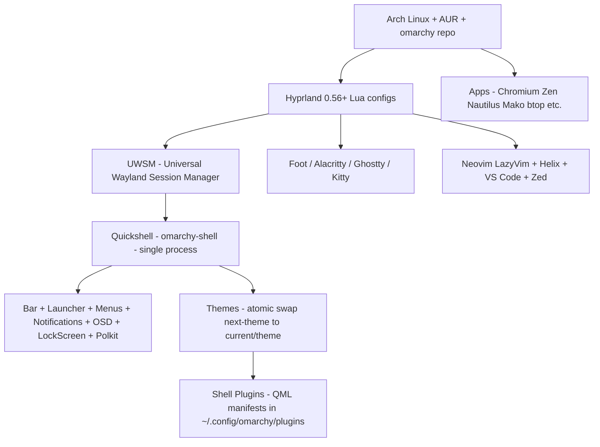

<div align="center">

# 🦊 Awesome Omarchy [](https://awesome.re)

**A curated, opinionated guide to Omarchy — DHH's beautiful, modern Arch Linux + Hyprland distribution.**

*The full desktop: Hyprland tiling, Quickshell shell, themes, tooling, apps, dotfiles, and everything you need to build a productive Linux workstation — from ISO to ricing.*

[](https://github.com/basecamp/omarchy/stargazers)
[](https://github.com/basecamp/omarchy/network/members)
[](https://github.com/basecamp/omarchy/commits/master)
[](LICENSE)
[](CONTRIBUTING.md)
[](https://discord.gg/omarchy)
[](https://archlinux.org)
[](https://hyprland.org)

[](https://omarchy.org)
[](https://learn.omacom.io/2/the-omarchy-manual)
[](https://commonmark.org)

</div>

---

## 📖 About

**Omarchy** is an opinionated Arch Linux + [Hyprland](https://hyprland.org) distribution by [DHH (David Heinemeier Hansson)](https://dhh.dk) — creator of Ruby on Rails and CTO of 37signals/Basecamp. It bottles DHH's daily driver into a reproducible, turnkey desktop: tiling window management, curated apps, cohesive themes, and keyboard-first workflows — all working out of the box, all infinitely ricable.

> Omarchy takes the "Arch on hard mode" and "Hyprland comes with nothing" problems and solves them with **one ISO, 5 minutes, full-disk LUKS encryption, and a desktop that is exactly what DHH runs every day** — then invites you to make it yours.

**Who this guide is for:** developers switching from macOS/Windows, Arch-curious tinkerers, Hyprland ricers, and teams evaluating Omarchy (37signals is moving Ops + Ruby teams to Omarchy by 2028).

**Legend:** ⭐ opinionated default · 🔓 open source · 💰 commercial / paid tier · ☁️ managed service · 🆓 free

**This guide is production-first:** every entry is something a working Omarchy user would actually install, configure, or study. The primer at the top of each section gives you the mental model; the tables give you the tools.


---

## 📑 Table of Contents

### Knowledge & Design

- 🧠 [Omarchy Fundamentals & Philosophy](#omarchy-fundamentals--philosophy)
- 🏗️ [Architecture Overview](#architecture-overview)
- 🎨 [Design & Aesthetics](#design--aesthetics)

### Setup & Installation

- ✅ [System Requirements & Prerequisites](#system-requirements--prerequisites)
- 💿 [ISO Installation (Full-Disk & Multi-Disk)](#iso-installation-full-disk--multi-disk)
- 🔧 [Manual Installation (Arch + Script)](#manual-installation-arch--script)
- 🖥️ [Virtual Machine & Dual-Boot](#virtual-machine--dual-boot)
- 🚀 [First Boot & Post-Install](#first-boot--post-install)

### Desktop Environment & Core Stack

- 🪟 [Hyprland & Window Management](#hyprland--window-management)
- 🐚 [Quickshell Desktop Shell (Omarchy 4+)](#quickshell-desktop-shell-omarchy-4)
- 📊 [Status Bar & Waybar (Legacy)](#status-bar--waybar-legacy)
- 🔍 [Application Launcher — Walker](#application-launcher--walker)
- 🔒 [Lock Screen, Idle & Session](#lock-screen-idle--session)
- 🔔 [Notifications, OSD & Polkit](#notifications-osd--polkit)

### Applications & Workflow

- ⌨️ [Keybindings Reference](#keybindings-reference)
- 🖥️ [Terminal & Shell](#terminal--shell)
- 📝 [Neovim & Editors](#neovim--editors)
- 🌐 [Browsers & Web Apps](#browsers--web-apps)
- 🤖 [AI & Coding Agents](#ai--coding-agents)
- 🛠️ [Shell Tools & CLI Essentials](#shell-tools--cli-essentials)
- 📟 [TUIs (Terminal UIs)](#tuis-terminal-uis)
- 🗂️ [GUI Apps & Commercial Apps](#gui-apps--commercial-apps)
- 📸 [Capture, Media & Creative](#capture-media--creative)
- 🎮 [Gaming & Windows VM](#gaming--windows-vm)
- 🌙 [Other Packages & Utilities](#other-packages--utilities)

### Themes & Customization

- 🎨 [Official Themes](#official-themes)
- 🌈 [Community Themes (100+)](#community-themes-100)
- 🧰 [Theme Tools & Managers](#theme-tools--managers)
- 🧩 [Theme System Architecture](#theme-system-architecture)
- 🧬 [Creating Your Own Theme](#creating-your-own-theme)

### System & Operations

- ⚙️ [Dotfiles & Configuration](#dotfiles--configuration)
- 🔌 [Shell Plugins (Quickshell)](#shell-plugins-quickshell)
- 🧭 [Omarchy CLI — `omarchy` Command Groups](#omarchy-cli--omarchy-command-groups)
- 📦 [Package Management (pacman, AUR, omarchy)](#package-management-pacman-aur-omarchy)
- 🔄 [Updates, Channels & Migrations](#updates-channels--migrations)
- 🔐 [Security, Encryption & Keyring](#security-encryption--keyring)
- 🖥️ [Hardware, Drivers & Peripherals](#hardware-drivers--peripherals)
- 🌐 [Networking, Bluetooth & Audio](#networking-bluetooth--audio)
- 💾 [Snapshots, Backups & Recovery](#snapshots-backups--recovery)

### Development, Learning & Community

- 📚 [Learning Resources & Manuals](#learning-resources--manuals)
- 📰 [Articles, Press & Blog Posts](#articles-press--blog-posts)
- 🎥 [Videos & Tutorials](#videos--tutorials)
- 💬 [Community & Support](#community--support)
- 🔗 [Related Projects (Omakub etc.)](#related-projects-omakub-etc)
- 📋 [Alternative Curated Lists](#alternative-curated-lists)
- 🛣️ [Roadmap & Releases](#roadmap--releases)

### Reference

- 🗂️ [Repository Layout & Base Packages](#repository-layout--base-packages)
- 🎓 [Courses & Deeper Dives](#courses--deeper-dives)
- 🤝 [Contributing](#contributing) · [Author](#author) · [License](#license)

---

## Omarchy Fundamentals & Philosophy

> Omarchy is **Arch Linux for humans who love the keyboard**: a curated, batteries-included Hyprland desktop that treats tiling, keyboard navigation, and cohesive theming as the product — not an afterthought. It is opinionated by design: DHH's defaults are the starting line, not a cage, and every choice is a dotfile you can override in `~/.config`.

### Key concepts

- **Omakase, not cafeteria** — like Omakub for Ubuntu, Omarchy ships *one* opinionated answer for each job (editor, terminal, bar, launcher) that all work together. You can swap any piece, but you never have to assemble from scratch.
- **Hyprland is the star** — a dynamic tiling Wayland compositor with smooth animations, gaps, blur, and workspaces. Windows tile automatically; you move focus with `Super + Arrow`, not the mouse.
- **Keyboard-first, mouse-second** — every important app has a direct `Super + …` binding; the app launcher (`Super + Space`) and Omarchy menu (`Super + Alt + Space`) are secondary, not primary.
- **Arch + AUR + omarchy repos** — rolling-release Arch gives you newest kernels/tools; the [AUR](https://aur.archlinux.org) gives you 90k+ community packages; Omarchy's own repo pins cohesive configs.
- **Config is code** — Hyprland switched to **Lua** in Omarchy 4 (Hyprland 0.56+) for expressive bindings (`o.bind(...)`), and Quickshell plugins are QML+JS. Dotfiles live in `~/.config`, never in `/usr/share/omarchy`.
- **Encryption by default** — full-disk **LUKS** is mandatory in the ISO path (and enforced in manual path). After decrypt, the user auto-logs in — security at the disk, speed at the desktop.
- **Ricing is a feature** — ~19 official themes + 100+ community themes, all atomic-switchable via `omarchy-theme-set`; the same choice that makes the default beautiful makes your rice trivial.

### Omarchy vs Omakub

| Aspect | [Omarchy](https://omarchy.org) | [Omakub](https://omakub.org) |
|---|---|---|
| Base | Arch Linux (rolling) | Ubuntu 24.04+ (LTS) |
| Compositor / DE | Hyprland (tiling, Wayland) | GNOME (floating, Wayland/X11) |
| Installer | Dedicated ISO (full-disk LUKS) or `curl … /install | bash` on Arch | `curl … /install | bash` on Ubuntu |
| Audience | Devs who want maximum control + keyboard flow | Devs who want familiar Ubuntu + curated dev setup |
| Look | Ultra-custom, cohesive, Hyprland-native | Polished GNOME with curated extensions/theme |
| AUR equivalent | AUR (90k+ packages) | Ubuntu PPAs + manual scripts |
| Both | By DHH / 37signals, MIT, free, `omarchy`/`omakub` CLIs, opinionated | Same ethos — try either in 20 min, keep the one you love |

### Who should (and shouldn't) use Omarchy

- **Great fit:** you love keyboard-driven workflows, want Arch + Hyprland without 10–20h of wiki spelunking, appreciate beautiful defaults but want to rice later, do most work in terminal/editor/browser.
- **Maybe not:** you need traditional panels/mouse workflows, require absolute minimalism, depend on heavy proprietary creative suites unavailable on Linux, or want legacy BIOS boot (Omarchy is UEFI-only).

### Canonical links

| Resource | URL |
|---|---|
| Website | [https://omarchy.org](https://omarchy.org) ⭐ |
| GitHub (source of truth) | [https://github.com/basecamp/omarchy](https://github.com/basecamp/omarchy) ⭐ 🔓 |
| Manual (Omacom) | [https://learn.omacom.io/2/the-omarchy-manual](https://learn.omacom.io/2/the-omarchy-manual) ⭐ |
| New Manual (omarchy.org) | [https://omarchy.org/manual/](https://omarchy.org/manual/) ⭐ |
| HEY World announcement | [https://world.hey.com/dhh/omarchy-is-out-4666dd31](https://world.hey.com/dhh/omarchy-is-out-4666dd31) |
| Installer script | [https://omarchy.org/install](https://omarchy.org/install) / [https://omarchy.org/install-bare](https://omarchy.org/install-bare) |

**[⬆ back to top](#table-of-contents)**

---

## Architecture Overview

> Omarchy is not "just a theme" — it is a **layered system**: Arch base + Hyprland compositor + Quickshell shell + curated apps + declarative dotfiles + atomic theme engine + plugin architecture. Everything is a file in `~/.config`; everything is restarted by a single shell process.

### Stack at a glance (Omarchy 4 Quattro)



### Layers

| Layer | Component | Config Location | Notes |
|---|---|---|---|
| Base OS | Arch Linux (rolling, btrfs, LUKS, Limine) | `/etc/`, `/boot/` | Limine bootloader, btrfs with compression, systemd + NetworkManager |
| Session | UWSM | `~/.config/uwsm/` | Launches Hyprland, manages env & app lifecycle |
| Compositor | Hyprland 0.56+ (Lua) | `~/.config/hypr/` | Lua `hyprland.lua`, `bindings.lua`, `monitors.lua`, `input.lua`, `looknfeel.lua`, `autostart.lua` |
| Shell (v4+) | Quickshell `omarchy-shell` | `~/.config/omarchy/shell.json` + `shell.toml` | Replaces Waybar/Walker/Mako/SwayOSD/hyprlock/swaybg/polkit-gnome — one process, pluginable |
| Shell (pre-v4) | Waybar + Walker + Mako + SwayOSD + hyprlock | `~/.config/waybar/`, `~/.config/walker/`, `~/.config/mako/` | Still documented for migration; atomic theme swap handled same way |
| Terminal | Foot ⭐ (default v4), Alacritty, Ghostty, Kitty | `~/.config/foot/foot.ini`, `alacritty.toml`, `ghostty/config` | Foot chosen in v4 for lower memory / faster startup |
| Theme engine | `omarchy-theme-set` (atomic) | `~/.config/omarchy/current/theme/` + `themes/` | Two-stage `next-theme` → `current/theme`, hooks, per-app setters |
| Plugins | Quickshell plugins | `$OMARCHY_PATH/shell/plugins/` + `~/.config/omarchy/plugins/` | `manifest.json` with `schemaVersion:1`, `id`, `kinds`, `entryPoints` (QML) |

### Data flow: theme switching (atomic)

1. User runs `omarchy-theme-set <name>` or `Super + Shift + Ctrl + Space` carousel
2. Copies theme dir → `~/.config/omarchy/current/next-theme/`, runs `omarchy-theme-set-templates` for generated configs (neovim, vscode, btop from 24-color palette)
3. Merges user overrides from `~/.config/omarchy/themes/`
4. Atomically swaps `next-theme` → `current/theme`, writes `theme.name`
5. Restarts terminals, bar/shell, notifications, lock screen, runs `omarchy-hook theme-set`

For deep source, see [DeepWiki: Theme System Architecture](https://deepwiki.com/basecamp/omarchy/7.1-theme-system-architecture) and `bin/omarchy-theme-set` in the repo.

**[⬆ back to top](#table-of-contents)**

---

## Design & Aesthetics

> Omarchy's design is **premium editorial + infrastructural**: near-black/navy mats, disciplined grids, mono utility labels, restrained accent halos, rounded corners where asked. Every theme is a *system*, not a wallpaper — terminal, neovim, btop, bar, launcher, notifications, lock screen, and browser new-tab all share one palette.

### Design tokens (per theme)

| Token group | Typical values | Used in |
|---|---|---|
| Background / foreground | `#0a0a0f`–`#1a1a2e` / `#e6e6e6`–`#f5f5f5` | Hyprland gaps, Alacritty, Waybar, Walker, foot |
| Accent / border gradients | `cyan #33ccff → green #00ff99`, `tokyo-night blue→magenta`, `rose-pine rose→pine` | Active window borders (animated loop), Waybar indicators |
| Rounding / gaps / blur | `rounding 10px`, `gaps_in 5`, `gaps_out 10`, `blur 8px Kawase 3 passes` | Looknfeel.lua, hyprland.conf |
| Animations | `bezier popin, slidefade`, 200–400ms ease | Window open/close, workspace switch |
| Icon set | Yaru-*, Papirus, or Yaru-prussiangreen-dark per theme | `icons.theme` → GTK |
| Font | JetBrainsMono Nerd Font ⭐ (basic, 200MB lighter in v4), Starship prompt | foot/alacritty/terminal, Waybar, shell |
| Wallpapers | 3–4 per theme in `backgrounds/` (winding-road Tokyo Night, Quattro, etc.) | `omarchy-theme-bg-next` + shell background |

### What makes Omarchy look premium

- **Unified chroma:** one palette generated into 24 semantic colors (`colors.toml`) → auto-generated `neovim.lua`, `vscode.json`, `btop.theme` (no hand drift)
- **Depth without clutter:** blur + vibrancy + transparency (active 70%, inactive 45%, fullscreen 90%) + dim inactive 15% + drop shadows
- **Motion restraint:** only window/workspace/indicator animations; idle desktop is event-driven (no polling → no CPU burn) in Quickshell
- **Corner controls:** integrated `rounded`/`sharp` toggle in v4 applied across Hyprland + notifications + lock + menus

**[⬆ back to top](#table-of-contents)**

---

## System Requirements & Prerequisites

> Omarchy is light (Hyprland + Wayland) yet GPU-aware. It runs on 4GB but shines on 16GB + modern Intel/AMD + 1440p/ultrawide/6K. UEFI + dedicated disk + wired/2.4GHz keyboard for LUKS are the only hard gates.

### Minimum & recommended

| Component | Minimum | Recommended | Notes |
|---|---|---|---|
| CPU | 64-bit Intel/AMD (x86_64) | Intel i5+ 8th gen / AMD Ryzen 5+ | Hyprland animations benefit from newer iGPU/dGPU; Asahi path exists for M-series Macs via manual install |
| RAM | 4 GB | 16 GB | Smooth animations + browser + docker + neovim; 8GB okay for VM |
| Storage | 20 GB dedicated disk | 60 GB+ SSD (NVMe) | ISO path **wipes entire selected drive** (GPT + EFI + LUKS btrfs); manual path can use a partition on btrfs |
| Graphics | Any KMS-capable | Intel UHD/Iris, AMD RDNA, NVIDIA (Wayland-friendly) | Hyprland is Wayland-native; games via GameScope launcher (AMD/Intel ARC/NVIDIA all supported) |
| Firmware | UEFI (no legacy BIOS) | UEFI with Secure Boot & TPM **disabled** | Required for Limine + LUKS; instructions below |
| Display | 1080p | 1440p / ultrawide / 6K 218ppi | Tiling shines on larger canvases; grouping + workspaces mitigate 1080p crowding |
| Input | Wired or 2.4GHz dongle keyboard | Same | **Bluetooth won't work at LUKS prompt** (pre-OS, like BIOS) |
| Network | Wired or Wi-Fi | Same | Installer needs internet; `iwctl` fallback documented for manual |
| Media | 8GB+ USB stick | Same | Flashed with balenaEtcher (Mac/Win) or Caligula/`dd` (Linux) |

### Before you flash

- **Backup** the target drive — ISO full-disk install is destructive and encrypted.
- **Disable** Secure Boot + TPM + Fast Boot in BIOS/UEFI (Security/Advanced tab). Framework laptops: `F2` → Secure Boot → Disabled → `F10` save.
- **Have wired input ready** for the LUKS password at every boot (after install, BT works inside Hyprland).
- **Download** the ISO from [omarchy.org](https://omarchy.org) (≈6.8GB for 3.4.2; varies). Verify device path with `lsblk` before `dd`.

**[⬆ back to top](#table-of-contents)**

---

## ISO Installation (Full-Disk & Multi-Disk)

> The **golden path**: download ISO → flash USB → disable Secure Boot → answer 7 prompts → pick disk → watch 2–10 min show → reboot → LUKS prompt → Hyprland. Designed for a *dedicated drive*; second disk = easy dual-boot with Windows/other OS.

### Flash the USB

| OS you are on | Tool | Steps |
|---|---|---|
| macOS | [balenaEtcher](https://etcher.balena.io) ⭐ (Intel x64 or arm64 dmg) | Flash from file → select ISO → select target USB → Flash → eject |
| Windows | [BalenaEtcher](https://etcher.balena.io) or [Rufus](https://rufus.ie) | SELECT → choose USB → GPT partition scheme → START |
| Linux | [Caligula](https://github.com/ifd3f/caligula) or `dd` | `sudo dd if=omarchy-*.iso of=/dev/sdX bs=4M status=progress oflag=sync` |

### BIOS/UEFI

1. Reboot → tap `F2`/`F9`/`F10`/`F11`/`F12`/`DEL`/`ESC` (varies) to enter setup.
2. **Disable** Secure Boot (+ TPM/Fast Boot). Save & exit.
3. Reboot → tap `F12` (Framework) / `F9` etc. → pick USB drive → boot Omarchy ISO (Plymouth LUKS splash).

### The 7 prompts (TEXT installer)

| # | Prompt | What to enter |
|---|---|---|
| 1 | Keyboard layout | Choose (e.g., English US, Dvorak). `Ctrl+C` here → *prepare for another owner* (deferred personal setup) |
| 2 | Username | Lowercase, no spaces |
| 3 | Password | Used for **user + root + LUKS** — make it strong |
| 4 | GitHub/full name & email | Optional; preconfigures `git config --global user.name/email` and `CapsLock Space E/N` expansions |
| 5 | Hostname | Machine name on LAN (default okay) |
| 6 | Timezone | Region/City (e.g., `Asia/Istanbul`, `America/Los_Angeles`) |
| 7 | Confirm summary | Yes → disk picker |

Pick the **target disk** (e.g., `/dev/sda` or `/dev/nvme0n1`). Confirm **Yes, format disk** → install begins (Limine + btrfs + LUKS + btrfs subvolumes + packages).

Time: ~1 min on fastest NVMe, 5–10 min typical, 8m26s on i5 4th gen + 16GB DDR3 (reported).

### First reboot

Plymouth LUKS prompt → enter password (wired/2.4GHz) → auto-login → **Hyprland** with two notifications: *Update System* + *Learn Keybindings (`Super+K`)*.

### Special modes

| Mode | How to trigger | When to use |
|---|---|---|
| **For another owner** | `Ctrl+C` on first (keyboard) screen → *prepare for another owner* | Family / employee / buyer hand-off; drive stays encrypted, personal setup deferred to their first boot (password becomes LUKS password) |
| **Unattended / fleet** | Put `omarchy.json` on a second drive alongside ISO | VMs / lab fleet — no keyboard, fully autonomous |
| **No encryption** | `Ctrl+C` on disk-format confirmation → switch to no-encryption | Throwaway / protected remote installs only |
| **Bare mode** (purist) | `https://omarchy.org/install-bare` via manual path | Skips Spotify/Pinta/OBS/LocalSend/etc — only minimal desktop |

### Dual-boot note

ISO is **full-disk** oriented. Dual-boot on *one* disk is not supported via ISO — use **two physical disks** (e.g., Disk 0 Windows, Disk 1 Omarchy) or the **manual install** below (replace Limine → GRUB, keep partitions, run `os-prober` + `grub-mkconfig`).

**[⬆ back to top](#table-of-contents)**

---

## Manual Installation (Arch + Script)

> For Asahi/M-series, single-disk dual-boot, or any setup where you must control partitions. You install Arch yourself (archinstall), then pipe DHH's script. Expect 5–30 min download depending on bandwidth.

### Steps

1. **Boot Arch ISO** (not Omarchy ISO) — `iwctl` for Wi-Fi if needed (`station wlan0 scan` → `station wlan0 connect SSID`).
2. **Run `archinstall`** with these choices (leave rest as-is):

| Section | Option |
|---|---|
| Mirrors | Regions → your country |
| Disk config | Partitioning → Default layout → select **target disk** |
| File system | btrfs (default structure: yes, use compression) |
| Disk encryption | **LUKS** → set password → **apply to partition** (critical — otherwise nothing encrypted) |
| Hostname | Your name |
| Bootloader | Limine |
| Auth | Root password + Add user → Superuser: Yes |
| Apps | Audio: pipewire |
| Network | Copy ISO network config |
| Timezone | Yours |

> ⚠️ LUKS must be actually applied to the partition or Omarchy's auto-login-after-decrypt assumption breaks.

3. Reboot → login as your new user on the Arch install.
4. **Install Omarchy:**

```bash
curl -fsSL https://omarchy.org/install | bash
# purist bare: curl -fsSL https://omarchy.org/install-bare | bash
```

It will `sudo`, ask for name/email (git + Compose expansions), then run solo for 5–30 min. Reboot when asked — you're in Omarchy.

### Dual-boot on a *partition* (keep Windows/GRUB)

The ISO uses **Limine**; dual-boot on one drive wants **GRUB**. MusaBase's proven recipe:

```bash
# 1) First attempt — will fail at limine.conf (expected)
curl -fsSL https://omarchy.org/install | bash

# 2) Stub Limine so installer thinks they're done
sudo tee /usr/local/bin/limine-update <<'SH' >/dev/null
#!/usr/bin/env bash
exit 0
SH
sudo tee /usr/local/bin/limine-mkinitcpio <<'SH' >/dev/null
#!/usr/bin/env bash
exit 0
SH
sudo chmod +x /usr/local/bin/limine-*

# 3) Re-run — this time it completes
curl -fsSL https://omarchy.org/install | bash
```

Reboot → **GRUB menu** → pick Arch entry → Omarchy desktop. Add Windows entries: `sudo os-prober && sudo grub-mkconfig -o /boot/grub/grub.cfg`.

If `systemd-resolved` vs `NetworkManager` fight kills Wi-Fi post-install: `sudo systemctl enable --now systemd-resolved` *or* `sudo systemctl enable --now NetworkManager` — pick one.

Full guides: [Omarchy Manual — Manual installation](https://learn.omacom.io/2/the-omarchy-manual/96/manual-installation) · [MusaBase: Separate Partition with GRUB](https://www.musabase.com/2026/06/install-omarchy-os-manually-separate-partition.html) · [iFixit: Installing Omarchy on Arch](https://www.ifixit.com/Guide/Installing+Omarchy+on+Arch/190367).

**[⬆ back to top](#table-of-contents)**

---

## Virtual Machine & Dual-Boot

> Want to try risk-free or keep Windows? VM via Proxmox/VirtualBox works great; bare-metal dual-boot wants two disks or the GRUB stub recipe above.

### Proxmox VE (3.4.2 example)

```bash
qm create 110 --name omarchy --memory 8192 --cores 4 --sockets 1 --cpu host \
  --bios ovmf --efidisk0 local-lvm:1,efitype=4m,pre-enrolled-keys=0 --machine q35 \
  --scsihw virtio-scsi-single --scsi0 local-lvm:60,iothread=1,discard=on \
  --ide2 local:iso/omarchy-3.4.2.iso,media=cdrom --boot order='ide2;scsi0' \
  --net0 virtio,bridge=vmbr0 --vga virtio,memory=64 --ostype l26 --agent 1 --tablet 1
```

- OVMF (UEFI) required; Q35 + virtio GPU best for Wayland. Upload ISO to storage first.
- Change boot order to disk after install; enter LUKS password on Plymouth prompt each boot.

VirtualBox: enable EFI in System, 128MB+ video memory, VBoxSVGA.

### Dual-boot recipes

| Situation | Path | Bootloader | Notes |
|---|---|---|---|
| Two physical disks | ISO installer per disk | Limine (each disk) | Select boot disk in BIOS (F12); no config fight |
| One disk, keep Windows | Manual install on a **btrfs partition** | GRUB (stub Limine) | After install: `os-prober` + `grub-mkconfig` adds Windows |
| VM + host | Proxmox/VBox + ISO | OVMF / Limine | No Secure Boot inside VM — already disabled by host |

Dedicated docs: [Framework Laptop 13 Guide](https://guides.frame.work/Guide/Omarchy+Linux+Installation+on+the+Framework+Laptop+13/564) (macOS/Windows USB creation, Secure Boot disable).

**[⬆ back to top](#table-of-contents)**

---

## Hyprland & Window Management

> Hyprland is the star. A **dynamic tiling Wayland compositor** with managed windows, gaps, blur, animations, workspaces, and window rules — all configured in `~/.config/hypr/*.lua` (Omarchy 4) or legacy `.conf`. Tiling is automatic; floating is the exception, triggered per app via `windowrulev2`.

### Primer

- **Tiling by default** — new windows tile in a binary split (dwindle/master); drag borders or `Super + Arrow` to resize/move.
- **Workspaces 1–9** — each monitor has independent workspaces; `Super + 1..9` jumps, `Super + Shift + 1..9` moves window.
- **Grouping** — `Super + G` groups windows into tabs; cycle with `Super + Tab`.
- **Floating & pin** — `Super + F` fullscreen, `Super + T` toggle float, `Super + O` pin overlay (Quattro), `Super + P` pin floating.
- **Lua config (v4)** — `hyprland.lua` sources `bindings.lua`, `monitors.lua`, `input.lua`, `looknfeel.lua`, `autostart.lua`; legacy `.conf` still supported via compat shims.

### Core files

| File | Purpose |
|---|---|
| `~/.config/hypr/hyprland.lua` ⭐ | Main entry — sources all modules |
| `~/.config/hypr/bindings.lua` | All keybindings (app launch, nav, window mgmt) |
| `~/.config/hypr/monitors.lua` | Monitor layout, scaling, and `monitors.conf` generation |
| `~/.config/hypr/input.lua` | Keyboard, mouse, touchpad, gestures |
| `~/.config/hypr/looknfeel.lua` | Gaps, rounding, blur, animations, border gradients, dim |
| `~/.config/hypr/autostart.lua` | Autostart apps + hooks |
| `~/.config/hypr/rules.lua` | `windowrulev2` — float, opacity, workspace pinning per app |
| `~/.config/hypr/environment.lua` | Env passthrough for UWSM |

### Window management patterns

| Action | Binding / Rule | Notes |
|---|---|---|
| Move focus | `Super + H/J/K/L` or Arrow | Vim-style with `Alt + H/J/K/L` in custom dotfiles |
| Swap window | `Super + Shift + H/J/K/L` | Dwindle swap |
| Resize | `Super + Alt + H/J/K/L` or drag border | Live resize |
| Kill | `Super + Q` | Closes active |
| Fullscreen | `Super + F` | Toggle |
| Toggle split | `Super + J / K` | Dwindle vs master |
| Group | `Super + G`, cycle `Super + Tab` | Tabbed container |

### Learning & reference

| Resource | Description |
|---|---|
| [Hyprland Wiki](https://wiki.hypr.land) ⭐ | Config, binds, window rules, plugins, multi-monitor |
| [Hyprland — Configuring Binds](https://wiki.hypr.land/Configuring/Basics/Binds) | `bind[d]` syntax, flags, submaps |
| [DeepWiki: Hyprland Configuration](https://deepwiki.com/basecamp/omarchy/4.1-hyprland-configuration) | Omarchy's layered sourcing explained |
| [Omarchy Manual — Hyprland](https://omarchy.org/manual/) | Looknfeel, monitors, keybinds via `omarchy show bindings` |
| [Hyprland Plugins](https://hypr.land/plugins) | hyprbars, hyprexpo, touchpad gestures |

**[⬆ back to top](#table-of-contents)**

---

## Quickshell Desktop Shell (Omarchy 4)

> **Quickshell (`omarchy-shell`) is Omarchy 4's unified shell** — one long-running QML/JS process replaces Waybar, Walker, Mako, SwayOSD, hyprlock, hypridle, swaybg, and polkit-gnome. The bar, launcher, menus, notifications, OSD, control panels, lock screen, and polkit all live inside it — fully themed, IPC-scriptable, and plugin-extensible. This is the biggest change since Omarchy 1.

### What changed in Quattro (v4.0.0 — 2026-08-14)

| Before (≤ v3.8) | After (v4 Quattro) |
|---|---|
| Waybar (bar) | Quickshell bar (`omarchy.bar`) |
| Walker + Elephant (launcher) | Quickshell launcher + menus |
| Mako (notifications) | Quickshell notifications |
| SwayOSD (OSD) | Quickshell OSD |
| hyprlock (lock) | Quickshell lock screen |
| swaybg (wallpaper) | Quickshell wallpaper |
| polkit-gnome | Quickshell polkit agent |
| hypridle | Quickshell idle (via `omarchy-shell`) |
| `~/.config/waybar/`, `walker/`, `mako/` | `~/.config/omarchy/shell.json` + `shell.toml` + `plugins/` |

All 30k+ new lines in `basecamp/omarchy#5856` — single-process, event-driven, theme-consistent.

### Shell config

| Location | Purpose |
|---|---|
| `~/.config/omarchy/shell.json` | Bar layout, plugin enable/disable, active bar id |
| `~/.config/omarchy/shell.toml` | Shell fine-tuning (font, anchor, transparency) |
| `~/.config/omarchy/plugins/` | Installed + cloned plugins (`<username>.<plugin>`) |
| `$OMARCHY_PATH/shell/plugins/` | Built-in plugins (read-only package source) |

```json
{
  "bar": {
    "id": "omarchy.bar",
    "position": "top",
    "layout": {
      "left":   [{ "id": "omarchy.menu" }],
      "center": [{ "id": "omarchy.clock", "format": "HH:mm" }],
      "right":  [{ "id": "omarchy.audio" }]
    }
  },
  "plugins": [{ "id": "community.weather-extra" }]
}
```

- `bar.id = "omarchy.bar"` → built-in bar; any `kind: "bar"` plugin replaces it entirely.
- Bar widgets declare `barWidget.defaultSection` (`left`/`center`/`right`) and `allowMultiple`.

### Inline modules (no plugin needed)

```json
{ "id": "vpn", "type": "command", "exec": "~/.config/omarchy/bar/scripts/vpn-status", "interval": 5, "onClick": "nm-connection-editor" }
{ "id": "gpu", "type": "qml", "source": "~/.config/omarchy/bar/modules/gpu.qml" }
```

`command` → plain text or Waybar JSON `{text, tooltip, class}`. `qml` → receives `bar`, `moduleName`, `settings`, `run(cmd)`, `shellQuote(v)`.

### Commands

| Command | Description |
|---|---|
| `omarchy menu` | Open Omarchy menu at root |
| `omarchy menu summon style.theme` | Jump to theme picker |
| `omarchy plugin add <git-url>` | Clone plugin → `~/.config/omarchy/plugins/<id>/` (disabled by default for review) |
| `omarchy plugin enable <id>` / `disable` | Toggle built-in or installed plugin |
| `omarchy plugin clone omarchy.clock` | Copy built-in → `~/.config/omarchy/plugins/<user>.clock/` (your editable copy, IPC-routed) |
| `omarchy plugin update [<id>]` | Fast-forward pull + diff preview |
| `omarchy plugin remove <id>` | Disable + delete/symlink-remove/backup |

Plugins are **unsandboxed QML** — review before `enable`; updates show diff; local changes block fast-forward.

### Migration

`Update > Omarchy` then `Update > Omarchy to Quattro`; `bar.id` migration rewrites legacy `Clock`/`AudioPanel` ids. Waybar/Walker configs kept as backup under `~/.config/waybar.bak.*` and `~/.config/walker/`.

Docs: [omarchy.org/manual/shell-plugins](https://omarchy.org/manual/shell-plugins) · `docs/omarchy-shell.md` in `quattro` branch · [Quickshell Docs](https://quickshell.org)

**[⬆ back to top](#table-of-contents)**

---

## Status Bar & Waybar (Legacy)

> Pre-Quattro bar: **Waybar** — CSS-styled, JSONC-configured, module-based. Still runs on v3.8 installs and is the fallback for users who postpone Quattro. Many custom dotfiles still target Waybar, so it is kept here for migration reference.

### Config locations (legacy)

| File | Purpose |
|---|---|
| `~/.config/waybar/config.jsonc` | Bar layout (`modules-left/center/right`, height, layer) |
| `~/.config/waybar/style.css` | CSS — colors injected from `~/.config/omarchy/current/theme/` |
| `~/.config/waybar/modules.json` | Shared module definitions |
| `~/.config/waybar/scripts/` | Helpers: `screen-recording.sh`, `vpn-status`, etc. |

### Default modules (Omarchy 3.x)

`hyprland/workspaces` · `clock` · `custom/omarchy` · `custom/update` · `custom/screenrecording-indicator` · `tray` · `bluetooth` · `network` · `pulseaudio` · `network` · `cpu` · `battery` · `custom/hypridle`

### Notable community Waybar projects

| Project | Stars | What it does |
|---|---|---|
| [HANCORE-linux/waybar-themes](https://github.com/HANCORE-linux/waybar-themes) | 588 | Omarchy-inspired Waybar theme pack for any distro |
| [atif-1402/minimal-waybar-themes](https://github.com/atif-1402/minimal-waybar-themes) | 221 | Minimal Waybar themes with Omarchy modules |
| [HANCORE-linux/quickshell-dots — Quickshell Rise](https://github.com/HANCORE-linux/quickshell-dots) | 154 | First custom Quickshell bar for Omarchy (post-Waybar) |
| [atif-1402/anomshell](https://github.com/atif-1402/anomshell) | 97 | Quickshell/Omarchy OS config |

**[⬆ back to top](#table-of-contents)**

---

## Application Launcher — Walker

> **Walker** (with **Elephant** backend) is the Omarchy launcher in v3.x — `Super + Space` opens a prefix-driven fuzzy launcher for apps, files, calculator, symbols, clipboard history, web search, and Omarchy menus. In Quattro, the launcher lives inside Quickshell but keeps the same prefixes and `omarchy-launch-walker` shim for scripts.

### How to launch

| Binding | Action |
|---|---|
| `Super + Space` | Walker — app launcher (default search: apps + menus + web fallback) |
| `Super + Ctrl + E` | Symbols/Emoji picker |
| `Super + K` | Keybindings viewer (via Walker) |
| `Super + Alt + Space` | Omarchy menu (Walker-powered) |
| `Super + Escape` | Power menu |
| `omarchy-launch-walker` | CLI; `walker --dmenu -p "prompt"` for scripts |

### Prefixes (type first)

| Prefix | Provider | Example |
|---|---|---|
| *(none)* | Desktop apps + menus + web | `spotify` → launch; `arch wiki` → web search |
| `=` | Calculator (`qalculate` via libqalculate) | `=50*1.08` → copy 54; `=sqrt(16)` |
| `$` | Clipboard history | `$` → browse, `Return` paste, `Ctrl+O` edit, `Ctrl+Shift+D` clear |
| `:` | Runner / commands | `:htop` |
| `.` | Files | `.Documents` |
| `;` | Unicode symbols / emoji | `; smile` |
| `@` | Web search | `@github hyprland` |
| `%` | Bookmarks *(optional plugin)* | `% docs` — requires `elephant-bookmarks` (AUR, version-matched) |

**Tips:** `Shift+Return` keeps Walker open; `Ctrl+E` toggles exact search; `Ctrl+H` clears history. Elephant providers live in `/etc/xdg/elephant/providers/`.

### Troubleshooting

| Symptom | Fix |
|---|---|
| Walker won't open | `pgrep -f "walker --gapplication-service"` → `omarchy-restart-walker` |
| No results | Toggle exact search off (`Ctrl+E`), verify `config/walker/config.toml` prefixes |
| `qalculate` error | `mkdir -p ~/.config/qalculate && touch ~/.config/qalculate/qalc.cfg` |
| Slow | `pgrep elephant` → restart; reduce `max_results` in config |

Docs: [GitHub Discussion #2835 — Comprehensive Walker Guide](https://github.com/basecamp/omarchy/discussions/2835) · `~/.config/walker/config.toml`

**[⬆ back to top](#table-of-contents)**

---

## Lock Screen, Idle & Session

> Lock, idle, suspend, and session are handled by **hyprlock + hypridle + UWSM** in v3, and by **Quickshell** (`omarchy-shell`) in v4. Either way, config is a file in `~/.config` you control.

### Stack

| Layer | v3.x | v4 Quattro |
|---|---|---|
| Session | UWSM (`uwsm app -- $TERMINAL`) | UWSM (same) |
| Wallpaper | swaybg | Quickshell wallpaper (per theme `backgrounds/`) |
| Lock | hyprlock (`~/.config/hypr/hyprlock.conf`) | Quickshell lock screen |
| Idle | hypridle (`~/.config/hypr/hypridle.conf`) | Quickshell idle |
| Polkit | polkit-gnome | Quickshell polkit agent |

### Controls

| Action | Command / Binding |
|---|---|
| Lock now | `Super + Shift + L` or `loginctl lock-session` / `omarchy menu system.lock` |
| Idle inhibit toggle | `omarchy toggle idle` / `custom/hypridle` Waybar module |
| Night light | `hyprsunset` — temperature resend-until-sticks on cold start |
| Screensaver | Runs on every monitor (v4 fix) |
| Branding | `~/.config/omarchy/branding/` — lock + Plymouth unlock screens |

Config via menu: `Setup > Configs > Hyprlock / Hypridle`.

**[⬆ back to top](#table-of-contents)**

---

## Notifications, OSD & Polkit

> Notifications, on-screen display (volume/brightness), and the privilege dialog are three separate daemons in v3 — one process in v4.

| Feature | v3.x daemon | v4 daemon | Config |
|---|---|---|---|
| Notifications | **Mako** (`~/.config/mako/config`) | Quickshell notifications | Per-theme vibrancy + rounding |
| OSD (audio/brightness) | **SwayOSD** (`~/.config/swayosd/style.css`) | Quickshell OSD | `swayosd/style.css` → shell theme |
| Polkit prompt | **polkit-gnome** | Quickshell polkit | Auto-starts with shell |
| Alerts | `~/.local/share/omarchy/notifications/` | Same (shell-notified) | Hooks for hooks/theme-set |

Set notification timeout/position in `mako/config`; OSD size/position in `swayosd` or `shell.toml` (v4).

**[⬆ back to top](#table-of-contents)**

---

## Keybindings Reference

> Hyprland is **keyboard-first, mouse-second**. `Super` is the mod key. Every important action is one chord. `Super + K` shows the full live map in Walker — this table is the printable cheat sheet.

### System & Omarchy

| Binding | Action |
|---|---|
| `Super + Alt + Space` | Omarchy menu (system control center) |
| `Super + Space` | App launcher (Walker / Quickshell launcher) |
| `Super + K` | Show all keybindings |
| `Super + Escape` | Power menu (Lock/Suspend/Logout/Restart/Shutdown) |
| `Super + Shift + L` | Lock screen |
| `Super + Ctrl + Space` | Cycle wallpaper (`omarchy-theme-bg-next`) |
| `Super + Shift + Ctrl + Space` | Theme carousel (v4 visual switcher) |
| `Super + Shift + T` | Cycle theme (`omarchy-theme-next`) |
| `Super + Shift + Ctrl + T` | Theme selector with preview |

### Window management

| Binding | Action |
|---|---|
| `Super + Q` | Close active window (`killactive`) |
| `Super + F` | Toggle fullscreen |
| `Super + T` | Toggle floating / tiling |
| `Super + G` | Group windows (tabs) · `Super + Tab` cycle |
| `Super + O` | Pop to pinned overlay (v4) |
| `Super + P` | Pin floating window |
| `Super + H/J/K/L` or Arrow | Move focus left/down/up/right |
| `Super + Shift + H/J/K/L` | Swap/move window |
| `Super + Alt + H/J/K/L` | Resize |
| `Alt + drag` | Move window with mouse |
| `Super + 1..9` | Go to workspace 1..9 |
| `Super + Shift + 1..9` | Move window to workspace 1..9 |
| `Super + Tab` | Next in group |

### Apps — launch

| Binding | Action |
|---|---|
| `Super + Return` | Terminal (default `Foot` in v4 · `$TERMINAL` env) |
| `Super + Alt + Return` | Terminal + tmux (or floating) |
| `Super + Shift + Return` | Chromium / default browser (`omarchy-launch-browser`) |
| `Super + Shift + B` | Browser (private) with `Super + Shift + Alt + B` |
| `Super + Shift + F` | File manager (Nautilus) |
| `Super + Shift + N` | Editor (Neovim) · `n` alias in terminal |
| `Super + Shift + M` | Music (Spotify) |
| `Super + Shift + T` | Activity / `btop` |
| `Super + Shift + D` | Docker / `lazydocker` |
| `Super + Shift + G` | Signal |
| `Super + Shift + O` | Obsidian |
| `Super + Shift + E` | HEY email |
| `Super + Shift + X` | X.com webapp (etc. — see `bindings.lua`) |

### Clipboard, capture & tools

| Binding | Action |
|---|---|
| `Ctrl + Shift + C/V` *unified* | Copy/paste everywhere (terminal + GUI) — Omarchy unified clipboard |
| `Super + C` / `Super + V` | Also copy/paste (Omarchy remap) |
| `Super + Shift + S` | Screenshot (drag region via `grim+slurp` → `tensaku`/`satty`) |
| `Super + Shift + R` | Screen recording (hit again to stop) — `omarchy capture screenrecording` |
| `Super + Shift + X` / custom | Text extraction (OCR) · Dictation (Voxtype `F9` when installed) |
| `Super + Ctrl + E` | Emoji/symbol picker |

### Overrides

User overrides → `~/.config/hypr/bindings.lua` (or `.conf` legacy). Sourced last, highest priority; use `unbind = SUPER, W` then `bindd = SUPER, W, ...`.

Full live reference: `Super + K` or `omarchy menu keybindings` or `omarchy show bindings`. Manual pages: [Hotkeys](https://omarchy.org/manual/hotkeys/) · [Hyprland Wiki — Binds](https://wiki.hypr.land/Configuring/Basics/Binds)

**[⬆ back to top](#table-of-contents)**

---

## Terminal & Shell

> The terminal is first-class. **zsh** is the default shell (Starship prompt, mise, fzf, zoxide, eza), **Foot** is the default terminal in v4 (lighter/faster; replaces Alacritty/Ghostty/Kitty as ⭐), with Alacritty/Ghostty/Kitty still installed and switchable via `Setup > Default Apps`.

### Shell

| Component | Choice | Config |
|---|---|---|
| Shell | **zsh** ⭐ | `~/.zshrc`, `~/.config/zsh/` |
| Prompt | **Starship** (`starship.toml`) | `~/.config/starship.toml` — dir + git only (minimal) |
| Version manager | **mise** (`~/.config/mise/config.toml`) | `mise latest` for Python/Node/pnpm; `PYTHON_VERSION=... ./setup/devenv_install.sh` pin |
| Fuzzy | **fzf** + **zoxide** | `Ctrl+R` history, `z <dir>` jump |
| Listing | **eza** (alias `ls`) | Icons, git status |
| Fastfetch | `~/.config/fastfetch/config.jsonc` | Omarchy branding on `fastfetch` |

### Terminals

| Terminal | Config | Notes |
|---|---|---|
| **Foot** ⭐ (v4 default) | `~/.config/foot/foot.ini` | Lowest memory, fastest startup, CSI-u `Shift+Return` for tmux panes |
| Alacritty | `~/.config/alacritty/alacritty.toml` | Previous default; reload on `touch` after theme switch |
| Ghostty | `~/.config/ghostty/config` | JetBrainsMono Nerd Font, minimal chrome |
| Kitty | `~/.config/kitty/kitty.conf` | Theme-synced |

All terminals import `~/.config/omarchy/current/theme/` colors via generated configs. Change default: `Setup > Default Apps > Terminal`.

### Shell helpers

| Helper | What it does |
|---|---|
| `omarchy-cmd-terminal-cwd` | Opens new terminal in CWD of focused window |
| `omarchy-launch-terminal` / `omarchy-launch-floating-terminal-with-presentation` | Tiling vs floating launch helpers |
| `xdg-terminal-exec` | Fallback so you never lose a working terminal |

**[⬆ back to top](#table-of-contents)**

---

## Neovim & Editors

> Omarchy ships a tuned **LazyVim** distro via the `omarchy-nvim` package: `Space` leader, fuzzy-find `Space Space`, grep `Space S G`, file tree `Space E`, `Shift+H/L` buffer nav, `Space G G` LazyGit. New in v4: default editor chooser (Neovim ⭐ / Helix / VS Code / Zed) and Foot CSI-u for `Shift+Return` tmux distinction.

### Launch

| How | Command |
|---|---|
| Hotkey | `Super + Shift + N` (default editor) |
| Terminal | `n` (= `nvim` aliased), `n myfile.txt`, `sudoedit /etc/...` (keeps plugins) |
| Inside Neovim | `:Lazy` → update, `:Lazy sync` headless: `nvim --headless -c "Lazy sync" -c "qa"` |

### LazyVim favorites

| Key | Action |
|---|---|
| `Space Space` | Fuzzy-find file |
| `Space S G` | Grep across project |
| `Space E` | Toggle file tree (`a` new file, `A` dir, `?` help, `Ctrl+W W` hop) |
| `Shift + H / L` | Prev/next buffer |
| `Space B D / B O` | Close buffer / close others |
| `Space G G` | LazyGit floating |
| `Space U W` | Soft wrap toggle |

### Other editors (also installed / choosable)

| Editor | Install | Config |
|---|---|---|
| **Helix** | `helix` | `~/.config/helix/config.toml` |
| [VS Code](https://code.visualstudio.com) | `code` | `~/.config/Code/User/settings.json` generated from `colors.toml` 24-palette |
| [Zed](https://zed.dev) | `zed` | Theming via Omarchy palette |
| Typora → **Omawrite** (v4) | `omawrite` | DHH's markdown editor replacement |

Docs: [Neovim manual](https://omarchy.org/manual/neovim/) · [LazyVim keymaps](https://www.lazyvim.org/keymaps) · [Typecraft — from scratch](https://www.youtube.com/watch?v=zHTeCSVAFNY) · [ThePrimeagen series](https://www.youtube.com/watch?v=X6AR2RMB5tE&list=PLm323Lc7iSW_wuxqmKx_xxNtJC_hJbQ7R)

**[⬆ back to top](#table-of-contents)**

---

## Browsers & Web Apps

> **Chromium** is ⭐ default for PWA/web-app integration; **Zen**, **Brave (Origin → stable in v4)**, **Firefox** also supported. `omarchy-launch-browser` / `omarchy-launch-webapp <url>` creates SSB-like app windows (high-res icons fetched in v4).

### Browser launchers

| Command | What it does |
|---|---|
| `omarchy-launch-browser` | Opens default browser (`Setup > Default Apps > Browser`) |
| `omarchy-launch-browser --private` | Private window |
| `omarchy-launch-webapp "https://x.com/"` | App window (separate icon, no URL bar) |
| `omarchy-webapp remove` | Remove web app |

### Pre-installed web app bindings (examples from `bindings.lua`)

| Key | App | URL |
|---|---|---|
| `Super + Shift + X` | X | https://x.com/ |
| + `Super + Shift + Alt + X` | X Post | https://x.com/compose/post |
| `Super + Shift + Alt + ...` | HEY, Basecamp, Google Contacts/Messages/Photos, ChatGPT, etc. | `omarchy-launch-webapp` per entry |

Change via `~/.config/hypr/bindings.lua` or clone and add your own:

```lua
o.bind("SUPER SHIFT, W", "WebApp — MyTool", "omarchy-launch-webapp 'https://mytool.example'")
```

Set default browser fallback: XDG `mimeapps.list` + `xdg-settings`; Omarchy falls back to MIME handler if no browser set.

**[⬆ back to top](#table-of-contents)**

---

## AI & Coding Agents

> **Omarchy 4 adds a first-class coding-agent layer**: choose your default agent, launch it in `~/Work` with the right trust, and see usage in the bar. Driven by the `omarchy-agent-*` helpers and the `agent` group in the `omarchy` CLI.

### Supported agents (v4)

| Agent | Trigger | Notes |
|---|---|---|
| **Claude Code** | `Super + Shift + Ctrl + A` (default agent key) | Status bar shows token/usage; launches in `~/Work` |
| **Codex** | `omarchy agent ...` | Via `omarchy agent` group |
| **OpenCode** | `omarchy agent` | Same launcher |
| **Pi** | `omarchy agent` | Pinned by community |
| **Gemini** | `omarchy agent` | Google CLI |
| **Grok** | `omarchy agent` | xAI CLI |
| **Muse** | `omarchy agent` | GitHub Copilot CLI |

Set default: `Setup > Default Apps > Agent` or `omarchy agent --help`. Status bar widgets: `omarchy.claude`, `omarchy.codex` family.

### Dictation & extraction

| Tool | Binding | What it does |
|---|---|---|
| **Voxtype** (opt-in, v3.8.2 + v4) | `F9` (bound only if installed) | Push-to-talk voice-to-text via `voxtype.service` + `omarchy-toggle-voxtype` |
| **Text extraction / OCR** | Screenshot → `tensaku` / `omarchy capture qr` | QR/region OCR |

CLI: `omarchy agent usage` · `omarchy capture qr`

**[⬆ back to top](#table-of-contents)**

---

## Shell Tools & CLI Essentials

> Omarchy preinstalls the curated shell toolkit so `grep` through `mise` just works on day one. All tools respect the theme where applicable; many are aliased or wrapped by `omarchy-cmd-*` helpers.

| Tool | Category | What it does |
|---|---|---|
| [ripgrep (`rg`)](https://github.com/BurntSushi/ripgrep) ⭐ | Search | Faster `grep`; `Space S G` in Neovim uses it |
| [fd](https://github.com/sharkdp/fd) | Search | Friendly `find` replacement |
| [fzf](https://github.com/junegunn/fzf) ⭐ | Fuzzy | Fuzzy history, file, and process pickers |
| [zoxide](https://github.com/ajeetdsouza/zoxide) | Navigation | `z <fragment>` — smarter `cd` |
| [eza](https://eza.rocks) | Listing | `ls` with icons, git, tree |
| [bat](https://github.com/sharkdp/bat) | Pager | `cat` with syntax + git gutters |
| [mise](https://mise.jdx.dev) ⭐ | Versions | `mise use node@22 python@3.12` — replaces nvm/pyenv/nodenv |
| [gh](https://cli.github.com) | Git | `gh auth login`, `gh pr create` |
| [git](https://git-scm.com) + [lazygit](https://github.com/jesseduffield/lazygit) | Git | `lg` alias; `Space G G` in Neovim |
| [starship](https://starship.rs) | Prompt | `~/.config/starship.toml` |
| [fastfetch](https://github.com/fastfetch-cli/fastfetch) | Sysinfo | `fastfetch` — branded system view |
| [jq](https://jqlang.github.io/jq/) / [yq](https://github.com/mikefarah/yq) | JSON/YAML | Pipe-native data slicing |
| [htop](https://htop.dev) / [btop](https://github.com/aristocratos/btop) | Monitor | `btop` themed from `colors.toml` |
| [curl](https://curl.se) / [wget](https://www.gnu.org/software/wget/) / [httpie](https://httpie.io) | HTTP | Fetch/inspect |
| [wl-clipboard](https://github.com/bugaevc/wl-clipboard) | Clipboard | `wl-copy`/`wl-paste` Wayland-native |
| [grim](https://gitlab.freedesktop.org/emersion/grim) + [slurp](https://github.com/emersion/slurp) | Capture | Screenshots → `tensaku` |
| [playerctl](https://github.com/alextheo27/playerctl) | Media | MPRIS control → bar widget |

Full installed set: run `pacman -Q` after install or see [Repository Layout & Base Packages](#repository-layout--base-packages).

**[⬆ back to top](#table-of-contents)**

---

## TUIs (Terminal UIs)

> TUIs get **first-class bindings** — `Super + Shift + <key>` opens a floating or fullscreen terminal TUI without hunting the launcher.

| TUI | Key | What it does |
|---|---|---|
| [btop](https://github.com/aristocratos/btop) ⭐ | `Super + Shift + T` (Activity) | Themed system monitor (CPU/mem/disk/net) |
| [lazygit](https://github.com/jesseduffield/lazygit) | `Space G G` in Neovim / terminal | Git porcelain TUI |
| [lazydocker](https://github.com/jesseduffield/lazydocker) | `Super + Shift + D` | Docker container/image TUI |
| [wiremix](https://github.com/tsirysndr/wiremix) | Bar audio panel | PipeWire mixer |
| [cava](https://github.com/karlstav/cava) | themed | Audio visualizer, follows palette |
| [qalculate (`qalc`)](https://github.com/Qalculate/libqalculate) | `=prefix` in Walker | Calculator backend |
| [superfile](https://superfile.netlify.app) / [yazi](https://yazi-rs.github.io) | supported by themes | File manager TUIs (themeable) |
| [opencode](https://github.com/sst/opencode) | agent launcher | `~/.config/opencode/` themed |

Launch pattern: `omarchy-launch-tui <cmd>` or `uwsm app -- $TERMINAL --class floating -e <cmd>`.

**[⬆ back to top](#table-of-contents)**

---

## GUI Apps & Commercial Apps

> Omarchy ships the desktop cant-`git-clone`-it stack preinstalled — editor, browser, mail, chat, office, creative. New apps in v4 are called out.

| App | Category | Notes |
|---|---|---|
| [Neovim](https://neovim.io) (LazyVim) ⭐ | Editor | `n` alias, `omarchy-nvim` pkg, theme-generated `neovim.lua` |
| [Helix](https://helix-editor.com) | Editor | Alternative default editor choice (v4) |
| [Chromium](https://www.chromium.org) ⭐ | Browser | Default; PWA/web-app host; Brave Origin stable in v4 |
| [1Password](https://1password.com) | Secrets | Native Wayland, `op` CLI |
| [Obsidian](https://obsidian.md) | Notes | Theme via `Appearance > Themes > Omarchy` (manual) |
| [Pinta](https://www.pinta-project.com) | Image | Lightweight Paint.NET-like editor |
| [OBS Studio](https://obsproject.com) | Recording | Studio-grade capture (gamescope session aware) |
| [LocalSend](https://localsend.org) | Share | AirDrop-like LAN sharing |
| [Spotify](https://spotify.com) | Music | `Super + Shift + M` |
| [Signal](https://signal.org) | Chat | `Super + Shift + G` |
| [Typora](https://typora.io) → **Omawrite** (v4) | Markdown | DHH's new editor replaces Typora |
| **Omacalc** (v4) | Calculator | Replaces GNOME Calculator |
| **Tensaku** (v4) | Annotate | Replaces Satty — image annotation |
| **Omacut** (v4) | Video | New ffmpeg-based trimmer |
| [LibreOffice](https://www.libreoffice.org) | Office | Writer/Calc/Impress |
| [Lazydocker](https://github.com/jesseduffield/lazydocker) | Docker GUI | Paired with Docker TUI |
| Web apps (Chromium SSB) | Mixed | HEY, Basecamp, ChatGPT, X, YouTube, Zoom, WhatsApp, Discord, Figma, Google Contacts/Messages/Photos, Fizzy — each is `omarchy-launch-webapp "<url>"`; easy to remove |

Remove bloat vs keep: `omarchy remove webapp <id>` or edit `bindings.lua` + `mako`/`waybar`/`shell` includes. Bare install skips Spotify/Pinta/OBS/LocalSend etc. (`/install-bare`).

**[⬆ back to top](#table-of-contents)**

---

## Capture, Media & Creative

> Screens, mics, and cameras are wired end-to-end — no `pactl set-source` archaeology.

| Feature | Tool / Command | Notes |
|---|---|---|
| **Screenshot** | `Super + Shift + S` → `omarchy capture screenshot` / `grim -g "$(slurp)"` → **Tensaku** / Satty | Drag region; annotate + copy/save |
| **Screen recording** | `Super + Shift + R` → `omarchy capture screenrecording [--fullscreen] [--with-desktop-audio] [--with-microphone-audio] [--with-webcam] [--resolution <size>]` | Hit again to stop; indicator in bar |
| **QR decode** | `omarchy capture qr` | Decode QR from region |
| **Audio panel** | `wiremix` / bar `omarchy.audio` | PipeWire mixer |
| **Video trim** | **Omacut** (`omacute`) | ffmpeg-based, new in v4 |
| **Wallpaper** | `omarchy-theme-bg-next` / `Super + Ctrl + Space` | Cycles `~/.config/omarchy/current/theme/backgrounds/` via `swaybg`/Quickshell |
| **Creative apps** | Pinta, OBS Studio, Kdenlive (opt.) | `Install > Video` etc. via menu |

Config: `~/.config/hypr/bindings.lua` (capture keys), `~/.config/omarchy/current/theme/backgrounds/` (wallpapers), bar `screenrecording-indicator`.

**[⬆ back to top](#table-of-contents)**

---

## Gaming & Windows VM

> Omarchy is a dev distro first, but **GameScope** + **Steam/RetroArch** + **Windows VM** are menu-installed so the same box can game/cross-test without dual-boot gymnastics.

| Feature | How to enable | Notes |
|---|---|---|
| **Steam + GameScope** | `Setup > Gaming > Steam` then `GameScope` | GameScope runs Steam Big Picture in a dedicated compositor session (like Steam Deck) — switch via SDDM |
| **RetroArch** | `Install > Gaming > Retroarch` | Fixed in 3.8.4 |
| **Lutris / Heroic** | `Install > Gaming > ...` | Wine/Proton launchers; Omarchy 3.7 Gaming Edition ships gaming kernel |
| **Gamescope session** | SDDM session chooser | Switch between Hyprland ↔ Gamescope |
| **Windows VM** | `Install > Windows VM` → `omarchy windows` group + `virt-manager` / `qemu` | `omarchy windows create/start/stop`; external drive auto-mount ENABLED in Z13/GTR scripts |
| **Custom kernel (ROG/GTR)** | CachyOS repos + custom `linux-cachyos` build (Panther Lake/ROG Z13 scripts) | `~6.19.13` + efficiency patches in 3.6 Panther Lake edition |

Docs: [Gaming manual](https://omarchy.org/manual/gaming/) · [ROG Z13 setup](https://github.com/Cliffback/omarchy-rog-z13-setup) · `omarchy windows --help`

**[⬆ back to top](#table-of-contents)**

---

## Other Packages & Utilities

> The long tail — every small utility that makes the desktop feel polished, from `qalculate` to `hyprsunset`.

| Package | What it does |
|---|---|
| `btop` | Themed process monitor (24-color generated `btop.theme`) |
| `hyprsunset` | Night light — temperature resend-until-sticks |
| `elephant` | Walker backend (systemd user `elephant.service`) |
| `qalculate` (`libqalculate`) | Calculator (`=`) backend |
| `gpu-screen-recorder` | Hardware-accelerated capture |
| `uwsm` | Universal Wayland Session Manager — env + app lifecycle |
| `limine` / ` Plymouth` | Bootloader (UEFI) + LUKS splash |
| `snapper` + `btrfs` | Snapshots + rollback (ALPM guard in v4) |
| `wiremix` | PipeWire mixer TUI |
| `xdg-desktop-portal-hyprland` | Screen/window share picker (Discord/Zoom/OBS) |

Full package list: `pacman -Q` or [DistroWatch package list](https://distrowatch.com/table-mobile.php?distribution=omarchy&pkglist=true&version=3.8.3) or `~/.local/share/omarchy/default/packages/` in the repo.

**[⬆ back to top](#table-of-contents)**

---

## Official Themes

> 19 cohesive, atomic-switchable themes in `basecamp/omarchy/themes/`. Each theme is a directory with `name`, `palette`, `colors` (24 semantic), and per-app generated configs (neovim/btop/vscode/waybar/walker/mako/hyprlock/swaybg/Chromium/GTK icons). `Super + Shift + Ctrl + Space` (v4) previews live; `omarchy-theme-set <name>` applies.

| Theme | Style | Preview | Notes |
|---|---|---|---|
| [Tokyo Night](https://github.com/basecamp/omarchy/tree/master/themes/tokyo-night) | dark, blue-mauve |  | **Default** — winding-road wallpaper ⭐ |
| [Catppuccin](https://github.com/basecamp/omarchy/tree/master/themes/catppuccin) | dark, pastel |  | Mocha palette |
| [Catppuccin Latte](https://github.com/basecamp/omarchy/tree/master/themes/catppuccin-latte) | **light**, pastel |  | Light variant |
| [Ethereal](https://github.com/basecamp/omarchy/tree/master/themes/ethereal) | dark, muted sage |  | Wallpaper toggle via `Super + Ctrl + Space` |
| [Everforest](https://github.com/basecamp/omarchy/tree/master/themes/everforest) | dark, green |  | Forest-inspired |
| [Flexoki Light](https://github.com/basecamp/omarchy/tree/master/themes/flexoki-light) | **light**, paper |  | Ink + paper tones |
| [Gruvbox](https://github.com/basecamp/omarchy/tree/master/themes/gruvbox) | dark, retro |  | Warm retro |
| [Hackerman](https://github.com/basecamp/omarchy/tree/master/themes/hackerman) | dark, green matrix |  | Hacker aesthetic |
| [Kanagawa](https://github.com/basecamp/omarchy/tree/master/themes/kanagawa) | dark, wave |  | Japanese wave palette |
| [Lumon](https://github.com/basecamp/omarchy/tree/master/themes/lumon) | dark, severance |  | Lumon branding |
| [Matterhorn / Matte Black](https://github.com/basecamp/omarchy/tree/master/themes/matte-black) | dark, near-black |  | Matte black shell |
| [Miasma](https://github.com/basecamp/omarchy/tree/master/themes/miasma) | dark, fog |  | Hazy |
| [Nord](https://github.com/basecamp/omarchy/tree/master/themes/nord) | dark, arctic |  | Nord palette |
| [Osaka Jade](https://github.com/basecamp/omarchy/tree/master/themes/osaka-jade) | dark, jade |  | Featured ⭐ |
| [Retro 82](https://github.com/basecamp/omarchy/tree/master/themes/retro-82) | dark, 80s |  | Neon 80s |
| [Ristretto](https://github.com/basecamp/omarchy/tree/master/themes/ristretto) | dark, coffee |  | Coffee tones |
| [Rose Pine](https://github.com/basecamp/omarchy/tree/master/themes/rose-pine) | dark, rose |  | Featured — rose/mauve |
| [Vantablack](https://github.com/basecamp/omarchy/tree/master/themes/vantablack) | dark, pure black |  | OLED pure black |
| [White](https://github.com/basecamp/omarchy/tree/master/themes/white) | **light**, clean |  | Stark white |

Unlock screens (Plymouth) per theme: `Style > Unlock` — Catppuccin, Ethereal, Everforest, etc. each have a LUKS decrypt splash.

Controls:

```bash
omarchy-theme-list                  # list
omarchy-theme-current               # current name
omarchy-theme-next                  # cycle (Super+Shift+T)
omarchy-theme-bg-next               # cycle wallpaper (Super+Ctrl+Space)
omarchy-theme-set tokyo-night       # set + generate + restart + BG
```

Install extra: `omarchy-theme-install https://github.com/<user>/omarchy-<name>-theme.git` or `Themes > Install` in menu/TUI.

Docs: [Manual — Themes](https://omarchy.org/manual/themes/) · [Unlock screens](https://omarchy.org/manual/themes/) · `bin/omarchy-theme-*` in repo

**[⬆ back to top](#table-of-contents)**

---

## Community Themes (100+)

> The community now maintains **233+ themes** (omarchythemes.com) + 160 `omarchy-theme` topic repos. The best are one-command installs via `omarchy-theme-install <git-url>`. Tables below are curated — full indexes linked at bottom.

### Most-starred community themes

| Theme | Author | Stars | Style | Install |
|---|---|---|---|---|
| [Aether](https://github.com/bjarneo/aether) | bjarneo | 618 | Native Omarchy theming, standalone-capable | `omarchy-theme-install https://github.com/bjarneo/aether.git` |
| [Ash](https://github.com/bjarneo/omarchy-ash-theme) | bjarneo | 48 | Minimal ash | `omarchy-theme-install https://github.com/bjarneo/omarchy-ash-theme.git` |
| [Futurism](https://github.com/bjarneo/omarchy-futurism-theme) | bjarneo | 36 | Futurism/Cyber | `omarchy-theme-install https://github.com/bjarneo/omarchy-futurism-theme.git` |
| [Pulsar](https://github.com/bjarneo/omarchy-pulsar-theme) | bjarneo | — | Space/noir | `omarchy-theme-install https://github.com/bjarneo/omarchy-pulsar-theme.git` |
| [Aura](https://github.com/bjarneo/omarchy-aura-theme) | bjarneo | — | Aura glow | same pattern |
| [Ayaka / Dracula / Monokai](https://github.com/Alexx2/omarchy-themes) | Alexx2 | 4 | Monokai, Dracula, Ayaka (anime) | per-folder install |
| [Copper Night](https://github.com/hembramnishant50-glitch/omarchy-coppernight-theme) | hembramnishant | 89 | Copper/velvet | `omarchy-theme-install https://github.com/hembramnishant50-glitch/omarchy-coppernight-theme.git` |
| [IBM / ThinkPad](https://github.com/DimaZbr/omarchy-ibm-theme) | DimaZbr | 49 | IBM heritage | `omarchy-theme-install https://github.com/DimaZbr/omarchy-ibm-theme.git` |
| [Solitude](https://github.com/HANCORE-linux/omarchy-solitude-theme) | HANCORE | 48 | Minimal | `omarchy-theme-install https://github.com/HANCORE-linux/omarchy-solitude-theme.git` |
| [Midnight (OLED)](https://github.com/JaxonWright/omarchy-midnight-theme) | JaxonWright | 44 | Inky OLED black | `omarchy-theme-install https://github.com/JaxonWright/omarchy-midnight-theme.git` |
| [BlackTurq](https://github.com/HANCORE-linux/omarchy-blackturq-theme) | HANCORE | 38 | Black + turquoise | same |
| [MechaNoOnna](https://github.com/HANCORE-linux/omarchy-mechanoonna-theme) | HANCORE | 38 | Mecha (メカ) | same |
| [C64](https://github.com/scar45/omarchy-c64-theme) | scar45 | — | Commodore 64 retro | same |
| [Manga](https://github.com/atif-1402/omarchy-manga-theme) | atif-1402 | — | Manga panels | same |
| [Matrix / Code green](https://github.com/omacom-io/omarchy-synthwave84-theme) | omacom-io | — | Synthwave '84 | same |
| [Kawasaki Foundry](https://github.com/komagata/omarchy-kawasaki-foundry-theme) | komagata | — | Kawasaki purple/pink | same |
| [Void / Vague](https://github.com/Rnedlose/omarchy-vague-theme) | vyrx-dev / Rnedlose | — | Void black, Vague muted | same |

### By palette / vibe

| Vibe | Themes |
|---|---|
| **Pastel** | Catppuccin, Rose Pine, Aura, Flexoki, Milky Matcha |
| **Pure black / OLED** | Matte Black, Vantablack, Noir, Void, Midnight, Miasma |
| **Retro / neon** | Retro 82, Synthwave '84, C64, NES, Pulsar, Futurism |
| **Nature / forest** | Everforest, Stillwood, Green Garden, Green City, Grudark, Hakker Green |
| **Anime / manga** | Ayaka, Manga, Akane (Japanese), MechaNoOnna, Aamis |
| **Light** | Catppuccin Latte, White, Flexoki Light, Bulwer, Venice From Above, Snow |
| **Blue / arctic** | Nord, Cobalt2, Krishna, Azure Glow, Blue Ridge Dark |
| **Corporate / iconic** | IBM, Dracula, Monokai, One Dark Pro, Material-ish |

### Deepakness Hub (82 curated) — excerpt

Full curated wall at [omarchy.deepakness.com/themes](https://omarchy.deepakness.com/themes) — 82 themes with preview + `#official/#unofficial/#dark/#light` tags. Highlights: **Stills in Motion** (art monochrome), **Noir** (muted sage), **Railroad Visions** (monochrome rail), **Perkins Harnly** (warm heritage), plus all official themes mirrored with `#official #popular`.

### Theme indexes (comprehensive)

| Index | Count | What it offers |
|---|---|---|
| [omarchythemes.com](https://omarchythemes.com) | 233 | Search, filter, install command, preview carousel — not affiliated with 37signals |
| [omarchytheme.com/themes](https://omarchytheme.com/themes/) | 100+ | Browse + one-command install, Limehawk-hosted, `github.com/limehawk/omarchy-theme-website` source |
| [bjarneo.github.io/omarchy-themes](https://bjarneo.github.io/omarchy-themes) | 233+ | Search `/`, `f` favorite, `y` copy wallpaper URL, palette-indexed |
| [github.com/topics/omarchy-theme](https://github.com/topics/omarchy-theme) | 160 repos | GitHub topic — filter by stars, language, update |
| [omarchy.deepakness.com/themes](https://omarchy.deepakness.com/themes) | 82 | Deepakness curated with unofficial/dark/light tags |
| [Ecosyste.ms — awesome-omarchy](https://awesome.ecosyste.ms/lists/aorumbayev/awesome-omarchy) | list | Ecosystem metadata |
| [awesome-omarchy (aorumbayev)](https://github.com/aorumbayev/awesome-omarchy) | 400+ stars | TUI `yay -Sy awesome-omarchy-tui-bin && awsomarchy` + curated list companion |

**[⬆ back to top](#table-of-contents)**

---

## Theme Tools & Managers

> Theme switching is atomic (`next-theme → current/theme`); tools wrap that with palette generation, previews, and app hooks.

| Tool | Language | What it does |
|---|---|---|
| [bjarneo/aether](https://github.com/bjarneo/aether) | Go | **Native Omarchy theming** — standalone, watches palette, regenerates app configs, hot-reloads bar |
| [bjarneo/peachy](https://github.com/bjarneo/peachy) | Go | TUI that generates terminal color themes from images (pywall/matugen pipeline) |
| [Tēma](https://github.com/topics/omarchy-theme) | JS | "Omarchy theming the easy way" — looking for maintainers |
| [Limehawk theme website](https://github.com/limehawk/omarchy-theme-website) | mixed | Powers omarchytheme.com browse + submit queue |
| `omarchy-theme-*` bin scripts | Bash | `list/set/next/bg-next/install/update/remove/current` — source of truth in `basecamp/omarchy/bin/` |
| `omarchy-theme-set-templates` | Bash | Regenerates `neovim.lua`, `vscode.json`, `btop.theme` from 24-color `colors.toml` |
| `omarchy-hook theme-set` | Bash hook | User hook invoked post-swap for custom app theming |
| [seeyouletter/omarchy-theme-manager](https://github.com/seeyouletter) | — | Community theme manager CLI |

Create from image: `peachy ./photo.jpg` → `colors.toml` + preview → `omarchy-theme-set`.

**[⬆ back to top](#table-of-contents)**

---

## Theme System Architecture

> Two-stage atomic swap with **palette generation** — `colors.toml` (24 semantic tokens) is the source of truth; per-app configs are generated, not hand-edited. User overrides in `~/.config/omarchy/themes/` layer on top of package defaults.

### Flow (from `bin/omarchy-theme-set`)

1. Resolve target theme name → source dir (`$OMARCHY_PATH/themes/<name>` vs `~/.config/omarchy/themes/<name>`)
2. Copy to `~/.config/omarchy/current/next-theme/`
3. `omarchy-theme-set-templates` → generate `neovim.lua`, `vscode.json`, `btop.theme` from `colors.toml` 24-palette
4. Merge user overrides from `~/.config/omarchy/themes/<name>/` (if present)
5. Atomic rename `next-theme` → `current/theme`; write `theme.name`
6. Touch Alacritty/Foot/Ghostty/Kitty configs → trigger reload; restart Waybar/Quickshell/Mako/SwayOSD/hyprlock/swaybg; apply GTK `gsettings` + `icons.theme` + Chromium `theme-color`; run `omarchy-hook theme-set`; cycle wallpaper via `omarchy-theme-bg-next` (`swaybg`/`quickshell wallpaper`).

### Directory layout per theme

| Path | Purpose |
|---|---|
| `theme/backgrounds/` | 3–4 wallpapers (e.g., `winding-road.jpg`) |
| `theme/colors.toml` | 24-color semantic palette (source of truth) |
| `theme/neovim.lua.template` | → generated `neovim.lua` |
| `theme/icons.theme` | GTK icon theme name |
| `theme/preview.png` | Menu/TUI preview |
| `theme/waybar/style.css`, `walker/config.toml`, `mako/config`, `hyprlock.conf` etc. | Per-app theme slices |
| `~/.config/omarchy/current/theme/` | **Active** theme (symlink-equiv) |
| `~/.config/omarchy/current/background` | Symlink to current wallpaper |
| `~/.config/omarchy/themes/` | User themes + overrides (layer 2) |
| `~/.local/share/omarchy/themes/` | Package defaults (layer 1, read-only) |

Reference: [DeepWiki: Theme System Architecture](https://deepwiki.com/basecamp/omarchy/7.1-theme-system-architecture) · `bin/omarchy-theme-set*` · `themes/<name>/colors.toml`

**[⬆ back to top](#table-of-contents)**

---

## Creating Your Own Theme

> Copy one existing theme, rename the palette, palettes → templates → preview → publish. The Omarchy Manual has the canonical walkthrough; this is the quick recipe.

### Steps (from [Manual — Making your own theme](https://omarchy.org/manual/))

1. **Copy:** `cp -r ~/.local/share/omarchy/themes/tokyo-night ~/.config/omarchy/themes/mytheme`
2. **Name:** edit `mytheme/name` or directory name (used by `omarchy-theme-list`)
3. **Palette:** edit `mytheme/colors.toml` — 24 keys (`background`, `foreground`, `red`, `green`, `yellow`, `blue`, `magenta`, `cyan`, grays) — or use `peachy` from an image.
4. **Icons:** set `mytheme/icons.theme` (e.g., `Yaru-prussiangreen-dark`) or omit → `Yaru-blue`
5. **Backgrounds:** drop wallpapers into `mytheme/backgrounds/` (any image, swaybg/Quickshell tiles them)
6. **Apply:** `omarchy-theme-set mytheme` — generates neovim/btop/vscode, restarts shell, previews.
7. **Tweak:** iterate on per-app files (`waybar/style.css`, `mako/config`, `walker/config.toml`, `hyprlock.conf`, `foot.ini`, `alacritty.toml`) — they hot-restart on save in v4.
8. **Publish:** `git init && git remote add origin https://github.com/<you>/omarchy-mytheme-theme.git && git push` — name convention `omarchy-<name>-theme` so `omarchy-theme-install <url>` derives the name correctly. Submit to [omarchytheme.com/issues/new?template=submit-theme.yml](https://github.com/limehawk/omarchy-theme-website/issues/new?template=submit-theme.yml) and tag with `omarchy-theme` topic.

### Theme helpers

| Helper | Command |
|---|---|
| Generate from image | `peachy ~/Pictures/wall.jpg --out ~/.config/omarchy/themes/mytheme` |
| Use Aether watcher | `aether --theme mytheme --watch` |
| Extract palette | `matugen image ~/Pictures/wall.jpg` → `colors.toml` compatible output |
| Test palette quickly | `omarchy-theme-set mytheme && omarchy-theme-bg-next` |

Full guide: [Manual — Making your own theme](https://omarchy.org/manual/themes/) · [Unlock screens guide](https://omarchy.org/manual/themes/) (custom Plymouth splash per theme)

**[⬆ back to top](#table-of-contents)**

---

## Dotfiles & Configuration

> **Rule zero:** edit `~/.config/...`, never `~/.local/share/omarchy/...`. Almost everything is editable via `Setup > Configs > [app]` (opens Neovim, restarts service on `:wq`). Legacy `.conf` vs new Lua: both work, Lua is ⭐ in v4.

### Key dotfiles

| File / Dir | What it controls |
|---|---|
| `~/.config/hypr/hyprland.lua` + `bindings.lua` + `monitors.lua` + `input.lua` + `looknfeel.lua` + `autostart.lua` | Hyprland — keybinds, monitors, input, gaps/blur/animations |
| `~/.config/hypr/monitors.conf` | Generated monitor map (don't edit by hand; use `Setup > Displays`) |
| `~/.config/omarchy/shell.json` + `shell.toml` + `plugins/` | **Quickshell** (v4) — bar layout, plugin enable/disable |
| `~/.config/waybar/` | **Waybar** legacy (v3) — bar config/style/scripts |
| `~/.config/walker/config.toml` | Walker launcher (v3) |
| `~/.config/mako/config` | Notifications |
| `~/.config/foot/foot.ini` / `alacritty/alacritty.toml` / `ghostty/config` / `kitty/kitty.conf` | Terminals — all theme-synced |
| `~/.config/nvim/` | Neovim (LazyVim) — `lazy-lock.json`, `lua/plugins/` |
| `~/.config/starship.toml` | Prompt |
| `~/.config/tmux/tmux.conf` | Tmux + theme sync |
| `~/.config/btop/btop.conf` + `themes/` | System monitor |
| `~/.config/omarchy/current/theme/` | **Active theme** (atomically swapped) |
| `~/.config/omarchy/themes/` | User themes + overrides |
| `~/.local/share/omarchy/` | Package defaults — don't edit; override in `~/.config` |

### Editing flows

| Flow | How |
|---|---|
| GUI | `Super + Alt + Space` → `Setup > Configs > [app]` → Neovim → `:wq` → auto-restart |
| Terminal | `n ~/.config/hypr/bindings.lua` → save → `hyprctl reload` (or `omarchy restart hypr`) |
| Reset one app | `omarchy reinstall configs --only <app>` or `Update > Config` in menu |
| Reset all | `omarchy reinstall configs` |
| Commit forbidden edits | `cd ~/.local/share/omarchy && git commit -am "Look ma! I'm breaking the rules!"` → allows `omarchy update` after |

### Community dotfiles to learn from

| Repo | What it shows |
|---|---|
| [sanjayrohith/Omarchy-Configs](https://github.com/sanjayrohith/Omarchy-Configs) | Matte-black amber shell, modular Waybar, Ghostty/Kitty/Alacritty all themed, LazyVim hot-reload |
| [jesus-molano/omarchy-dotfiles](https://github.com/jesus-molano/omarchy-dotfiles) | Vim `Alt+hjkl` navigation, `keyd` hyper (Caps→Hyper), tmux/starship/fastfetch |
| [Cliffback/omarchy-rog-z13-setup](https://github.com/Cliffback/omarchy-rog-z13-setup) | Full ROG Z13 hardware enablement — kernel, asusd, audio, Hyprland tablet, TDP menu, Gamescope |
| [mswell/dotfiles](https://github.com/mswell/dotfiles) | Wellpunk tri-theme (dark/light/tokyo), walker+hyprlock sync, bug-bounty toolkit, WSL variant |
| [ahasdemir/hyprland_configs](https://github.com/ahasdemir/hyprland_configs) | Omarchy/CachyOS hybrid — Waybar/SwayOSD/Zsh/Walker/Mako |

Docs: [Manual — Dotfiles](https://learn.omacom.io/2/the-omarchy-manual/65/dotfiles) · [Manual — Monitors](https://learn.omacom.io/2/the-omarchy-manual/) · [Hyprland import tips — Gist bindings.conf](https://gist.github.com/semeano/121ac12d4569ef356d35b52d52e4ac4e)

**[⬆ back to top](#table-of-contents)**

---

## Shell Plugins (Quickshell)

> **Plugins are the new extensions.** One manifest + QML per plugin; built-ins live in `$OMARCHY_PATH/shell/plugins/`, yours in `~/.config/omarchy/plugins/<id>/`. The shell hot-reloads on save; the menu exposes Enable/Disable/Add/Clone/Remove.

### Plugin lifecycle

| Command | What it does |
|---|---|
| `omarchy plugin add https://github.com/acme/omarchy-weather.git` | Clone → `~/.config/omarchy/plugins/acme.weather/` (**disabled** — review before `enable`) |
| `omarchy plugin add <url> --enable` | Clone + enable immediately |
| `omarchy plugin enable acme.weather` | Enable (shows code warning first time) |
| `omarchy plugin disable acme.weather` | Disable without deleting |
| `omarchy plugin clone omarchy.clock [--edit]` | Copy built-in → `~/.config/omarchy/plugins/<user>.clock/` (renamed "My Clock", IPC-routed, switch-back on remove) |
| `omarchy plugin update [id]` | Fast-forward pull + diff preview; blocks if local changes can't fast-forward |
| `omarchy plugin remove <id>` | Disable + delete (git checkout), unlink (symlink), or backup with timestamp (hand-made folder) |

Menu: `Setup > Plugins` → Enable/Disable (both built-in + installed), Add, Clone (built-ins), Remove (installed only).

### Manifest (`manifest.json`)

```json
{
  "schemaVersion": 1,
  "id": "acme.weather",
  "name": "Weather Extra",
  "version": "1.0.0",
  "kinds": ["bar-widget", "service"],
  "entryPoints": { "bar-widget": "Widget.qml", "service": "Service.qml" },
  "barWidget": { "displayName": "Weather", "category": "System", "defaultSection": "right", "allowMultiple": false }
}
```

### Kinds

| Kind | What it is |
|---|---|
| `bar-widget` | Drop-in bar component (`bar.layout.left/center/right`) |
| `bar` | **Full bar** — replaces `omarchy.bar` entirely |
| `panel` | Persistent or summoned floating window |
| `overlay` | Fullscreen overlay |
| `menu` | Summoned menu surface |
| `service` | Headless singleton, no UI |

A plugin can declare multiple kinds (e.g., media = `service` + `bar-widget`).

### Config (where settings live)

- **New way (Quattro):** settings are **inline** on `shell.json` entries — no nested `config:` sub-object, no merge layers.
- Example: `{ "id": "omarchy.clock", "format": "HH:mm" }` directly in `bar.layout.center`.
- Full plugin example: `{ "id": "community.weather-extra", "city": "Istanbul", "units": "metric" }` in `plugins[]`.

### Finding plugins

| Source | Count | Link |
|---|---|---|
| Plugin Marketplace (built-in + community) | 500+ | `Setup > Plugins > Add` (v4) · [Omarchy News — plugin competition](https://omarchy.org/news/) |
| GitHub topic | — | Search `omarchy-plugin` / `quickshell` + `omarchy` |
| Community examples | — | `HANCORE-linux/quickshell-dots`, `atif-1402/anomshell`, plus marketplace listings |

Docs: [Manual — Shell Plugins](https://omarchy.org/manual/shell-plugins) · `docs/omarchy-shell.md` (quattro branch) · [Quickshell](https://quickshell.org)

### Community plugins

| Plugin | Kinds | What it does |
|---|---|---|
| [OmaCards](https://github.com/nocstah/omacards) 🔓 | `bar-widget`, `service` | Open, edit and flip saved window cards, set workspace destinations, and adjust motion and shortcuts · requires Hyprflip |

**[⬆ back to top](#table-of-contents)**

---

## Omarchy CLI — `omarchy` Command Groups

> The **`omarchy` CLI** is the control plane for agents and humans. Every menu action is a CLI command; every CLI command takes `--help`. Run bare `omarchy` for the dashboard; `omarchy commands --json` for machine-readable.

### Common commands

| Command | What it does |
|---|---|
| `omarchy` | Dashboard + usage |
| `omarchy update` | Update Omarchy + system packages (respects channel) |
| `omarchy theme list` / `set <name>` / `next` / `current` / `bg-next` / `install <url>` / `remove <name>` / `update` | Theme lifecycle |
| `omarchy font list` / `set` | Font lifecycle |
| `omarchy screenshot` / `capture screenrecording [--fullscreen] [--with-desktop-audio]` | Capture |
| `omarchy debug` | Diagnostic dump for bug reports / `omarchy upload logs` |
| `omarchy menu [summon style.theme]` | Scriptable menu (jump, toggle, close) |
| `omarchy plugin add/update/remove/enable/disable/clone` | Plugin lifecycle (Quattro) |
| `omarchy commands [--all] [--json] [--check]` | List all commands (JSON for agents) |
| `omarchy <group> --help` / `<group> <cmd> --help` | Group/command help |

### All groups (from `omarchy commands`)

| Group | Description | Examples |
|---|---|---|
| `agent` | AI coding agent usage data | `omarchy agent usage` |
| `audio` | Audio I/O controls | `omarchy audio set-output`, `volume` |
| `bar` | Shell bar layout & settings | `omarchy bar --help` |
| `battery` | Battery helpers | `omarchy battery status` |
| `bluetooth` | Device controls | `omarchy bluetooth connect` |
| `branch` | Git branch mgmt for `~/.local/share/omarchy` | `omarchy branch switch dev` |
| `branding` | About + screensaver branding |  |
| `brightness` | Display + keyboard brightness |  |
| `capture` | Screenshots & recording | `omarchy capture qr`, `screenrecording` |
| `channel` | Release channel mgmt | `omarchy channel get/set` |
| `clipboard` | Clipboard helpers |  |
| `cmd` | Command & shortcut helpers |  |
| `config` | System config helpers |  |
| `debug` | Diagnostics + logs | `omarchy debug`, `upload` |
| `display` | Monitor mgmt |  |
| `font` | Font lifecycle | `omarchy font list` |
| `install` | App/package installers | `omarchy install neovim` etc. |
| `menu` | Scriptable menu | `omarchy menu summon ...` |
| `network` / `wifi` | Network helpers |  |
| `plugin` | Quickshell plugins | `omarchy plugin add ...` |
| `refresh` / `reinstall` / `remove` / `restart` / `setup` / `share` / `snapshot` / `state` / `sudo` / `swayosd` / `system` / `theme` / `toggle` / `tui` / `tz` / `update` / `upload` / `version` / `voxtype` / `webapp` / `windows` | One group per `bin/omarchy-*` | |
| `version` | Version + channel info | `omarchy version` |
| `voxtype` | Dictation | `omarchy voxtype toggle` |

For the legacy `omarchy-*` bin names (each group ↔ `bin/omarchy-<group>-<cmd>`), see [bin/ — CLI utilities](https://docs.docuwriter.ai/omarchy-user-docs/78798) and `bin/` in the repo.

**[⬆ back to top](#table-of-contents)**

---

## Package Management (pacman, AUR, omarchy)

> **pacman** for official Arch + Omarchy repos, **yay** (or `paru`) for AUR, **`omarchy-pkg-*` helpers** for idempotent scripts. Omarchy 4 adds **ALPM guard** — direct `sudo pacman -Syu` is intercepted; go through `omarchy update` so snapshots, disk-space checks, and channel pins run.

### Commands

| Command | When to use |
|---|---|
| `omarchy update` ⭐ | **Day-to-day** — updates Omarchy + system, respects channel, creates snapshot, checks disk |
| `sudo pacman -Syu` | Blocked by ALPM guard in v4 — use `omarchy update` |
| `yay -S <pkg>` | AUR install (or `paru`) |
| `yay -Syu` | AUR full upgrade (after `omarchy update`) |
| `omarchy-pkg-add <pkg>` | Idempotent "install if missing" (scripts) |
| `omarchy-pkg-remove <pkg>` | Idempotent remove |
| `pacman -Q` / `pacman -Qs <term>` | List / search installed |
| `pacman -Qi <pkg>` | Package info |

### Repos & keys

- Official **Arch** + **Omarchy** repo (`omarchy` PKGBUILD group) + **CachyOS** (on ROG/GTR/custom-kernel installs).
- `omarchy-theme-update` → `git pull` for Git-installed themes.

**[⬆ back to top](#table-of-contents)**

---

## Updates, Channels & Migrations

> Rolling release, but with guardrails: **channels** (stable/dev), **offline-safe snapshots**, **migrations** (`install/migrations/*.sh` run once via `omarchy-migrate`), and **branch pin** to avoid accidental `dev` drift.

### Channels

| Channel | What it tracks | Switch |
|---|---|---|
| `stable` ⭐ | Tagged releases (`v3.8.x`, `v4.0.0`) | `omarchy channel set stable` |
| `dev` | `master`/`dev` branch rolling | `omarchy channel set dev` |
| `quattro` | `quattro` branch (pre-v4) | `Update > Omarchy to Quattro` in menu |

Boot channel bugs fixed in 3.8.2 (wrong channel on boot) — ensure `~/.config/omarchy/channel` is correct after migration.

### Upgrade paths

| From → To | How |
|---|---|
| Any 3.x → latest 3.x | `Update > Omarchy` (or `omarchy update`) from menu |
| 3.x → 4 Quattro ⭐ | `Update > Omarchy` → then `Update > Omarchy to Quattro` (ISO `omarchy-4.0.0.iso` for fresh) |
| Quattro beta → 4.0.0 | `omarchy update` (Quattro channel) |

### Migrations & safety

- `omarchy-migrate` runs pending `install/migrations/*.sh` once, tracking success/failure.
- `omarchy-reinstall-git` pinned to `master` in 3.8.1 hotfix (prevents accidental `dev` switch).
- **ALPM guard** (v4) prevents raw `pacman -Syu` from skipping snapshots/disk checks.
- **Disk-space check** before update (auto in v4).
- **Snapper snapshots** — rollback if anything breaks (`omarchy snapshot`).

Use `omarchy debug` + `omarchy upload logs` (Omarchy-owned log container since 3.8.2) for bug reports.

**[⬆ back to top](#table-of-contents)**

---

## Security, Encryption & Keyring

> **LUKS full-disk is mandatory** in the ISO path (password = user + root + disk). Auto-login after decrypt keeps cold-boot security without desktop friction. v4 adds disk-space gating + ALPM snapshot guard.

### At install

| Choice | Effect |
|---|---|
| **Encrypted** ⭐ | `btrfs` on LUKS, GPT + EFI, Limine + Plymouth decrypt splash. Wired/2.4GHz keyboard required at prompt. |
| **No encryption** | `Ctrl+C` on format confirmation → skip LUKS. Only for throwaway/protected remote hosts. |

### At runtime

| Feature | Tool |
|---|---|
| Auto-login after LUKS | systemd + UWSM (no display manager) |
| Keyring | `gnome-keyring` / `kwallet` via `~/.local/share/keyrings/`, polkit (Quickshell agent in v4) |
| Hardware auth | `Setup > Hardware Auth` — fingerprint (where supported), YubiKey via PAM (`hw auth` docs) |
| Snapshots | Snapper + btrfs — `omarchy snapshot create/restore` + GRUB/Limine snapshot boot |
| Disk checks / ALPM guard | v4 pre-update checks; blocks raw `pacman -Syu` |

Docs: [Manual — Security](https://omarchy.org/manual/security/) · [Manual — System snapshots](https://omarchy.org/manual/system-snapshots/) · [Manual — Hardware authentication](https://omarchy.org/manual/hardware-authentication/)

**[⬆ back to top](#table-of-contents)**

---

## Hardware, Drivers & Peripherals

> Omarchy's hardware story is "**DHH's picks + Framework official**." Star picks below are DHH's Good Linux Hardware shortlist and Framework's community-supported/seeded tiers.

### Recommended hardware (DHH's [Good Linux Hardware](https://learn.omacom.io/3/omacom/74/good-linux-hardware))

| Tier | Model | Why it shines | CPU | Notes |
|---|---|---|---|---|
| ⭐ Laptop | **Dell XPS 14/16 (Panther Lake 358H, OLED)** | Favorite — Apple M-chip level perf/efficiency, tandem OLED, >12h battery, light | Panther Lake | Premium pick |
| ⭐ Laptop | **Framework 13 Pro** | Best keyboard, 3:2, repairable, nerd's nerd box | Panther Lake | DIY upgradeable |
| Value laptop | **Dell XPS 13** | $699 US launch — 120Hz matte, great KB, Wildcat single-core | Wildcat | Needs beefier SSH host for heavy builds |
| Enthusiast | **TUXEDO InfinityBook Pro 14 Gen10** | 3K matte, 80Wh (+1/3 vs FW13), dual NVMe, 5×USB + HDMI + eth, 1.45kg | — | Tiny right-Shift on ANSI |
| Creator/Gamer | **ASUS ROG Zephyrus G14 (2026 GU405)** | 2.8K OLED that "pops", NVIDIA options, MacBook build, user-serviceable SSD/Wi-Fi/battery | + NVIDIA | Gaming + local LLM |
| ⭐ Mini PC value | **Beelink EQR5** ($289, Zen3 5825U) | "Just try it" — cheap enough to experiment | 5825U | Try-before-premium |
| ⭐ Mini PC sweet spot | **Beelink SER8** ($499, Zen4 8745HS, 32GB/1TB) | DHH's daily driver in NYC/CPH/Malibu; Geekbench 2750 SC / 13500 MC | 8745HS | Most recommended |
| ⭐ Mini PC mid | **Beelink SER9** (~$929, HX370) | Best iGPU, better Wi-Fi vs SER8 | HX370 | Creative iGPU need |
| Premium mini | **Beelink GTR9 Pro / Framework Desktop** | GTR9: 395+ /128GB, 20 containers + 3 VMs responsive; Framework Desktop: 395+ MAX, 16C/40CU, 192GB | 395+ (MAX) | Different tradeoffs — both excellent |
| Wildcard | **Old ThinkPads / any mini with Intel/AMD iGPU** | Tiling shines on 1440p/ultrawide; 1080p still great with groups | — | "Old ThinkPads resurrected" |

### Framework tiers (official)

| Tier | Meaning | Omarchy status |
|---|---|---|
| Ubuntu Certified / Fedora Ready | Formal partnership, internal validation | — |
| **Community supported** | Community self-validates against Framework checklist; Framework seeds hardware, keeps open escalation | **Omarchy is Community supported** (formal tier) |
| **Hardware seeding** | Framework sends hardware to promising distros for compatibility work | **Omarchy is also Hardware seeded** — listed alongside CachyOS, EndeavourOS, Bazzite, NixOS, Mint |

### Peripherals & tuning

| Area | How |
|---|---|
| Monitors | `Setup > Displays` → generates `~/.config/hypr/monitors.conf`; named `eDP-1` entry required for `iio-hyprland` rotation + scaling cycle; ultrawide/6K@218ppi recommended |
| Keyboard/Mouse/Trackpad | `Setup > Keyboard/Mouse/Trackpad` → `~/.config/hypr/input.conf`; caps→Hyper via `keyd` (see `jesus-molano/omarchy-dotfiles`) |
| ROG / Z13 special | [omarchy-rog-z13-setup](https://github.com/Cliffback/omarchy-rog-z13-setup): CachyOS kernel, `asusd` fix, CS35L41/ALC294 audio, tablet input, quick TDP menu (`Super+Shift+Q`), iio rotation daemon, Gamescope |
| Backup phrase | Use a wired or 2.4GHz keyboard for LUKS — **BT is dead pre-OS** |

Docs: [Manual — Monitors](https://omarchy.org/manual/monitors/) · [Manual — Keyboard/Mouse/Trackpad](https://omarchy.org/manual/keyboard-mouse-trackpad/) · [Framework — Linux Compatibility](https://frame.work/linux) · [Phoronix — Framework 13 Pro review (Panther Lake DIY)](https://www.phoronix.com/review/framework-laptop-13-pro)

**[⬆ back to top](#table-of-contents)**

---

## Networking, Bluetooth & Audio

> Network, BT, and audio are **PipeWire + WirePlumber + NetworkManager** — with a menu-driven CLI on top. ROG Z13 has a known ALC294 `soft-mixer` quirk fixed by removing the global config.

### Stack

| Layer | Tool |
|---|---|
| Network | NetworkManager + `systemd-resolved` (pick one if Wi-Fi breaks post-install: `enable --now` the one you want) |
| Bluetooth | `bluetoothd` + bar `omarchy.bluetooth` widget (Quickshell) / Waybar `bluetooth` module |
| Audio | PipeWire + WirePlumber + `wiremix` mixer TUI + `pulseaudio` bar module |
| Portals | `xdg-desktop-portal-hyprland` — screen/window picker for Discord/Zoom/OBS |

### Commands & menus

| Action | How |
|---|---|
| Wi-Fi connect | `Setup > Network` or `nmcli` / `nmtui` |
| Bluetooth pair | `Setup > Bluetooth` or `bluetoothctl` |
| Audio switch | Click bar audio → `wiremix` or `pavucontrol`; ROG Z13: ALC294 HDMI auto-profile fixed by Z13 setup |
| Installer Wi-Fi (Arch ISO) | `iwctl station wlan0 scan → station wlan0 connect SSID` |

Docs: [Manual — Networking](https://omarchy.org/manual/networking/) · Wi-Fi clash fix (resolved vs NM): `systemctl enable --now systemd-resolved` vs `NetworkManager`

**[⬆ back to top](#table-of-contents)**

---

## Snapshots, Backups & Recovery

> **btrfs + Snapper + Limine** gives you time travel. Omarchy 4 adds ALPM guard + disk-space check so you don't snapshot yourself into oblivion.

| Task | Command |
|---|---|
| Create snapshot | `omarchy snapshot create` (auto before `omarchy update` in v4) |
| List / restore | `omarchy snapshot list` / `restore <id>` → Limine snapshot boot entry |
| Manual `snapper` | `sudo snapper list` / `sudo snapper create --description "before rice"` |
| Dotfiles backup | `chezmoi` or `git` your `~/.config` (see community dotfiles list above); or copy `~/.config/hypr`, `waybar`/`shell`, `omarchy` |
| Full disk | `dd` / `clonezilla` for offline image; Omarchy's btrfs subvolumes already snapshot-aware |

Docs: [Manual — System snapshots](https://omarchy.org/manual/system-snapshots/) · [Snapper wiki](https://wiki.archlinux.org/title/Snapper)

**[⬆ back to top](#table-of-contents)**

---

## Learning Resources & Manuals

> Two manuals (old Omacom + new omarchy.org) cover the same desktop with slightly different depth. Start with the new manual, fall back to Omacom for Omakase doctrine, hardware notes, and exiting-the-Mac essays.

| Resource | What it is |
|---|---|
| [The Omarchy Manual (new — omarchy.org/manual)](https://omarchy.org/manual/) ⭐ | Canonical v4 manual — 50 chapters: Welcome → Unattended Installs, with Quickshell/plugin content |
| [The Omarchy 3 Manual (Omacom — learn.omacom.io)](https://learn.omacom.io/2/the-omarchy-manual) | Legacy but deeper on philosophy: [Omakase Computing](https://learn.omacom.io/3/omacom/76/omakase-computing), [Doctrine](https://learn.omacom.io/3/omacom/81/doctrine) |
| [Getting Started](https://learn.omacom.io/2/the-omarchy-manual/50/getting-started) | ISO vs manual install, first boot |
| [Manual — Omarchy CLI](https://omarchy.org/manual/omarchy-cli/) | Every `omarchy <group> <cmd>` with `--help` |
| [Manual — Themes](https://omarchy.org/manual/themes/) | Visual switcher, backgrounds, unlock screens |
| [Manual — Hotkeys](https://omarchy.org/manual/hotkeys/) | Full hotkey map + unified clipboard |
| [Manual — Dotfiles](https://learn.omacom.io/2/the-omarchy-manual/65/dotfiles) | `~/.config` vs `~/.local/share/omarchy` |
| [Manual — Shell Plugins](https://omarchy.org/manual/shell-plugins) | QML plugin authoring |
| [Manual — Neovim](https://omarchy.org/manual/neovim/) | LazyVim starter |
| [Manual — Terminal](https://omarchy.org/manual/terminal/) | Foot + shell helpers |
| [Hyprland Wiki](https://wiki.hypr.land) | Compositor reference — binds, rules, animations, multi-monitor |
| [Arch Wiki](https://wiki.archlinux.org) | Package management, LUKS, btrfs, NetworkManager, PipeWire |
| [Quickshell Docs](https://quickshell.org) | QML shell API for plugin devs |
| `docs/omarchy-shell.md` (quattro branch) | Quickshell architecture + bar inline modules |
| [DeepWiki — basecamp/omarchy](https://deepwiki.com/basecamp/omarchy) | AI-generated architecture deep dives: Hyprland config (4.1), Theme system (7.1) |

**[⬆ back to top](#table-of-contents)**

---

## Articles, Press & Blog Posts

> DHH and the community document the switch to Omarchy in public —from launch essays to deep hardware posts. These are the canonical reads; the video section has the watch-alongs.

| Date | Article | Author/Source | Summary |
|---|---|---|---|
| 2025-06-26 ⭐ | [Omarchy is out](https://world.hey.com/dhh/omarchy-is-out-4666dd31) | DHH (HEY World) | Launch essay: Arch + Hyprland opinionated desktop; sister to Omakub |
| 2025-07-03 | [Living with Linux and Android after two decades of Apple](https://world.hey.com/dhh/living-with-linux-and-android-after-two-decades-of-apple-4f730084) | DHH | Why he left macOS after 20 years — privacy, openness, control |
| 2025-08-09 | [All-in on Omarchy at 37signals](https://world.hey.com/dhh/all-in-on-omarchy-at-37signals-68162450) | DHH · SpicyTakes | 37signals moving Ops + Ruby (→ Framework Laptops/Desktops) to Omarchy by 2028 |
| 2025-09-05 | [Omarchy Review — The BEST Linux Distro I've Ever Used](https://ethanthompson.org/blog/omarchy-review) | Ethan Thompson | Framework 13 review — "like first time on macOS, clean & fun" |
| 2025-10-09 | [TheStandup — DHH Talks Omarchy (Primeagen)](https://www.youtube.com/watch?v=ljGPvgMPOn8) | ThePrimeagen / DHH | Long-form conversation on Linux + Omarchy |
| 2025-11-06 | [DHH and Omarchy: Midlife crisis — Rust in Peace](https://blogs.gnome.org/alatiera/2025/11/06/dhh-and-omarchy-midlife-crisis) | Alatiera (GNOME blog) | Critical GNOME-community take |
| 2025-08-17 | [This One Command Turned My Arch Install Into a Beautiful Hyprland Setup](https://itsfoss.com/news/omarchy/) | Sourav Rudra (It's FOSS) | First-look review — "Arch on hard mode, solved in one command" |
| 2025-11-13 | [A Word on Omarchy — Divisions by zero (Lemmy/OP full critique)](https://piefed.blahaj.zone/post/364811) | kennedy@lemmy.dbzer0 | Technical critique thread (partitioning, bloat, "is it even a distro") |
| 2025-12-20 | [Omarchy Linux: Why This Opinionated Arch+Hyprland Distro Is Winning Developers](https://www.thinklet.blog/omarchy-linux-review-arch-hyprland) | Kartik Maurya (Thinklet) | 11-min review: Omarchy vs Ubuntu/Fedora, keyboard mastery, benchmarks |
| 2026-01-03 | [The $499 Mac Killer: How DHH's Omarchy Turned Mini PCs Into Workstations](https://www.starryhope.com/minipcs/omarchy-linux-mini-pcs-2025/) | Jim Mendenhall (Starry Hope) | Beelink SER8 ($499, 32GB/1TB, GB 2750/13500) — the Omarchy hardware economics deep dive |
| 2026-02-06 | [Omarchy: DHH Made an Arch Linux Distro, and It's Actually Pretty Good](https://fivenines.io/blog/omarchy-what-it-is-how-it-works) | Sébastien Puyet (FiveNines) | Balanced take — usability wins vs Arch DIY tax |
| 2026-02-15 | [My Terminal Setup in 2026: Ghostty, tmux, Neovim](https://nick-liu.com/posts/my-terminal-setup-2026/) | Nick Liu | Terminal evolution piece citing Omarchy defaults |
| 2026-03-20 | [How to Install Omarchy OS — Arch-Based Hyprland Desktop](https://computingforgeeks.com/install-omarchy-arch-hyprland-linux/) | Josphat Mutai | 6-min install guide — LUKS, Hyprland first boot, theme switcher |
| 2026-03-27 | [Omarchy — Grokipedia](https://grokipedia.com/page/omarchy) | Grokipedia | Community encyclopedia entry (releases, issues, Hyprland notes) |
| 2026-04-14 | [Hyprland Setup Guide: Install and Configure (2026)](https://petronellatech.com/blog/hyprland-setup-guide-install-configure-2026) | Craig Petronella | 2026 Hyprland guide — Arch/NixOS/Fedora, binds, Waybar/Wofi, Catppuccin/Tokyo Night |
| 2026-05-27 | [Arch + Hyprland Setup = Omarchy! — LinuxCommunity.io](https://linuxcommunity.io/t/arch-hyprland-setup-omarchy/5280/1) | LinuxCommunity.io | Forum thread with community dotfile showcases |
| 2026-08-19 | [Omarchy 4 (Quattro) In-Depth Review](https://dashen-tech.com/en/dev-tools/omarchy-4-quattro-review) | Dashen Tech | 30k stars, 26.3k GitHub stars review — Quickshell unified shell, themes (Last Horizon/Solitude/Lupine), Foot/Omawrite, agent integration |
| — | [Exiting the Mac · Omacom](https://learn.omacom.io/3/omacom/72/exiting-the-mac) | DHH | The broader macOS exit thesis (Omacom book) |
| — | [Omacom — Omakase Computing](https://learn.omacom.io/3/omacom/76/omakase-computing) | DHH | The omakase doctrine — "leave it to the chef" |
| — | [Omacom — Doctrine](https://learn.omacom.io/3/omacom/81/doctrine) | DHH | Linux doctrine behind Omarchy's opinions |
| — | [Good Linux Hardware](https://learn.omacom.io/3/omacom/74/good-linux-hardware) | DHH | Laptop/mini PC shortlist (Dell XPS, Framework, Beelink, TUXEDO, Zephyrus) |

**[⬆ back to top](#table-of-contents)**

---

## Videos & Tutorials

> Prefer watching to reading? These are the essential Omarchy / Hyprland video paths — from DHH's Lex Fridman appearance to community install timelapses and ThePrimeagen's reaction.

| Video | Creator | What it covers |
|---|---|---|
| [Omarchy is out — launch clips](https://world.hey.com/dhh/omarchy-is-out-4666dd31) (screenshots in post) | DHH | Launch-day desktop tour |
| [Why DHH switched to Linux (from macOS) — Lex Fridman](https://www.youtube.com/watch?v=S_RqZG6YR5M) | Lex Fridman × DHH | Two-decade Apple → Linux thesis |
| [TheStandup — DHH Talks Omarchy](https://www.youtube.com/watch?v=ljGPvgMPOn8) | ThePrimeagen / TheStandup | Long-form Omarchy conversation |
| [ThePrimeagen — Omarchy literally fixed everything](https://x.com/ThePrimeagen/status/1975913165511897226) | ThePrimeagen (X) | "Good Linux desktop experience for years — this is it" |
| [How to Install Omarchy OS: The Arch Linux Hyprland OS by DHH](https://www.musabase.com/2026/05/how-to-install-omarchy-os.html) | MusaBase | 8:26 install on i5-4th gen, LUKS, first boot walkthrough |
| [Install Omarchy OS Manually — Separate Partition with GRUB](https://www.musabase.com/2026/06/install-omarchy-os-manually-separate-partition.html) | MusaBase | One-disk dual-boot with Windows (GRUB stub recipe) |
| [Omarchy Review: Worth Ditching Ubuntu For? (2026)](https://www.youtube.com/watch?v=3W326Uw676U) | Community | Preconfigured Arch + Hyprland vs Ubuntu |
| [10 Hyprland Dotfiles to Transform Your Linux Desktop](https://itsfoss.com/best-hyprland-dotfiles) | It's FOSS | ML4W, JaKooLit, HyDE, Caelestia, Gdots — Omarchy in context |
| [Caelestia Shell and Hyprland Setup: Ultimate 2026 Guide](https://www.tenotes.com/blog/caelestia-shell-and-hyprland-setup-the-ultimate-2026-guide-to-linux-perfection) | Tenotes (Mohamed Karms) | Quickshell sibling project deep dive (transferable to Omarchy 4) |
| [Best Hyprland Dotfiles 2026 — MusaBase roundup](https://www.musabase.com/p/best-hyprland-dotfiles-for-linux.html) | MusaBase | Omarchy placement vs HyDE/JaKooLit/ML4W/Caelestia |
| [Omarchy 4 — Quickshell deep dive](https://github.com/basecamp/omarchy/pull/5856) | DHH (PR) | 30k-line PR — full shell replacement walkthrough |
| [Framework Laptop 13 Pro — Phoronix video + review](https://www.phoronix.com/review/framework-laptop-13-pro) | Phoronix | Panther Lake DIY build — DHH's laptop family |
| [The Framework Desktop is a beast](https://world.hey.com/dhh/the-framework-desktop-is-a-beast-636fb4ff) | DHH (HEY World) | AMD 395+ (128GB, 16C/40CU) mini monster |

### Official channels to follow for new drops

| Channel | Why |
|---|---|
| [DHH @dhh](https://x.com/dhh) | Release announcements, hardware posts, Quattro betas |
| [@Omarchy on X](https://x.com/omarchy) (if present) | Project account |
| [basecamp/omarchy Releases](https://github.com/basecamp/omarchy/releases) · Watch → Custom → Releases | Release notifications |
| [omarchy.org/news](https://omarchy.org/news/) | Plugin competition, Core Team, Foundation ($8M) news |
| [r/omarchy](https://www.reddit.com/r/omarchy/) · [r/hyprland](https://www.reddit.com/r/hyprland/) | Daily dotfile showcases, troubleshooting |

**[⬆ back to top](#table-of-contents)**

---

## Community & Support

> ~28k stars, 2.9k forks, 500+ issues/PRs active, Discord + Reddit + GitHub Discussions — all linked from the installer.

| Channel | Link | What for |
|---|---|---|
| **GitHub** ⭐ | [basecamp/omarchy](https://github.com/basecamp/omarchy) | Issues, PRs, Releases, Discussions |
| **Website** | [omarchy.org](https://omarchy.org) | Download ISO, manual, news |
| **Manual (new)** | [omarchy.org/manual](https://omarchy.org/manual/) | Canonical docs (v4) |
| **Manual (legacy)** | [learn.omacom.io](https://learn.omacom.io/2/the-omarchy-manual) | Doctrine + 3.x docs |
| **Discord** | `discord.gg/tXFUdasqhY` (via DistroWatch) / `discord.gg/omarchy` | Live help, screenshots, theme shares |
| **Reddit** | [r/omarchy](https://www.reddit.com/r/omarchy/) · [r/hyprland](https://www.reddit.com/r/hyprland/) | Showcases, "My Waybar" custom configs, workstations |
| **X / Twitter** | [@dhh](https://x.com/dhh) | News, Quattro betas, hardware picks |
| **DistroWatch** | [distrowatch.com/omarchy](https://distrowatch.com/omarchy) | Stats: #31/12mo, rating 8.7/10 (39 reviews) |
| **DistroWatch Gallery** | [Gallery](http://distrowatch.com/gallery.php?distribution=omarchy) | Screenshots per release |
| **Omarchy Workstations** | [omarchy.org/workstations](https://omarchy.org/workstations/) + [omarchy.deepakness.com/setups](https://omarchy.deepakness.com/setups) | Curated workstation photos — where to place the Beelink/Framework |
| **Framework Community** | [community.frame.work](https://community.frame.work) | Hardware issues, fingerprint, Wi-Fi, Panther Lake kernel notes |
| **Bug reports** | `omarchy debug` → `omarchy upload logs` → paste in GitHub Issue | Use Omarchy-owned log container since 3.8.2 |

**[⬆ back to top](#table-of-contents)**

---

## Related Projects (Omakub etc.)

> Omarchy has siblings and cousins — all by DHH or community remixes of the same omakase idea.

| Project | Link | Relationship |
|---|---|---|
| **Omakub** ⭐ | [omakub.org](https://omakub.org) · [github.com/basecamp/omakub](https://github.com/basecamp/omakub) | **Sister project** — opinionated *Ubuntu + GNOME* for devs; try this if Arch rolling isn't for you |
| **Omakase Computing** | [learn.omacom.io/3/omacom/76/omakase-computing](https://learn.omacom.io/3/omacom/76/omakase-computing) | The doctrine essay behind both Omarchy and Omakub |
| **Omacom Foundation** | [omarchy.org/news/2026/08/omacom-foundation-launches-with-8-million](https://omarchy.org/news/2026/08/omacom-foundation-launches-with-8-million/) ($8M, Aug 2026) | Funds Omarchy + Omakub |
| **Omarchy for WSL** | [github.com/hypn/omarchy-for-wsl](https://github.com/hypn/omarchy-for-wsl) | Community port of Omarchy feel to Windows WSL |
| **Omarchy ROG Z13 Setup** | [github.com/Cliffback/omarchy-rog-z13-setup](https://github.com/Cliffback/omarchy-rog-z13-setup) | Hardware specialization — 76 commits, 6 phases, Z13-tuned Hyprland + kernel + audio |
| **Caelestia Shell** | [github.com/caelestia-dots/shell](https://github.com/caelestia-dots/shell) | Quickshell-based bar family — spiritual cousin to Quattro |
| **ML4W Dotfiles** | [mylinuxforwork.github.io/dotfiles](https://mylinuxforwork.github.io/dotfiles/) | Full-featured Hyprland distro layer; installer + settings app |
| **HyDE / JaKooLit / End4** | [hyprland dotfiles roundup](https://www.musabase.com/p/best-hyprland-dotfiles-for-linux.html) | The wider Hyprland dotfiles lineage Omarchy draws from |

**[⬆ back to top](#table-of-contents)**

---

## Alternative Curated Lists

> This list is one view; the ecosystem has others — each with its own filter (Ecosyste.ms for dependency graph, aorumbayev's list for TUI-first curation, MusaBase for distro-tester comparisons).

| List | Stars | Focus | URL |
|---|---|---|---|
| **awesome-omarchy (aorumbayev)** | 411 | TUI + one-command install, AUR helper | [github.com/aorumbayev/awesome-omarchy](https://github.com/aorumbayev/awesome-omarchy) · [awesome-omarchy.com](https://awesome-omarchy.com) (`yay -Sy awesome-omarchy-tui-bin`) |
| **mylinuxforwork / ML4W** | — | Professional Hyprland — installer + theme selector + settings GUI | [mylinuxforwork.github.io](https://mylinuxforwork.github.io/dotfiles/) |
| **JaKooLit Hyprland-Dots** | — | Cross-distro (Arch/Fedora/Ubuntu) Hyprland rice | [github.com/JaKooLit/Hyprland-Dots](https://github.com/JaKooLit/Hyprland-Dots) |
| **HyDE Project** | — | Theme-centric, adaptive material colors | [github.com/HyDE](https://github.com/HyDE) |
| **Ecosyste.ms — awesome-omarchy index** | — | Dependency graph + transitive Awesome index | [awesome.ecosyste.ms/lists/aorumbayev/awesome-omarchy](https://awesome.ecosyste.ms/lists/aorumbayev/awesome-omarchy) |
| **It's FOSS — 10 Hyprland Dotfiles** | — | Editorial top 10 (ML4W, JaKoolit, Caelestia, Gdots, Rainz) | [itsfoss.com/best-hyprland-dotfiles](https://itsfoss.com/best-hyprland-dotfiles) |

**[⬆ back to top](#table-of-contents)**

---

## Roadmap & Releases

> **Latest is Quattro (v4.0.0, 2026-08-14)** — the 30k-line Quickshell rewrite. Stable channel stays on v3.8.x with backports; dev/quattro tracks `master`/`quattro` branches.

### Recent releases (from [Releases](https://github.com/basecamp/omarchy/releases))

| Version | Date | Codename / Theme | Highlights | ISO |
|---|---|---|---|---|
| **v4.0.0** ⭐ | 2026-08-14 | **Quattro** | Quickshell shell (bar/launcher/notifications/OSD/lock/polkit/wallpaper in one process), plugin architecture (500+ marketplace), visual theme carousel (`Super+Shift+Ctrl+Space`), Last Horizon/Solitude/Lupine themes, Foot (default), Omawrite, Omacalc, Tensaku, Omacut, agent layer (`Super+Shift+Ctrl+A`), dual-boot auto-detect | `iso.omarchy.org/omarchy-4.0.0.iso` |
| v3.8.5 → v4.0.0-beta3 | 2026-05–08 | Alpha → Beta | Quattro stabilization: IPC, theme carousel, agent status widgets | — |
| **v3.8.4** | 2026-07-21 | Fixes | Neovim theme symlink, RetroArch installer, Foot bindings migration, Waybar restart | `omarchy-3.8.4.iso` |
| v3.8.3 | 2026-07-14 | Additions | tmux pane `Alt+Enter` + CSI-u `Shift+Return` across Alacritty/Foot/Ghostty/Kitty | `omarchy-3.8.3.iso` |
| v3.8.2 | 2026-06-24 | Compat | Omarchy-owned log container, Hyprland 0.55 compat, channel-boot fix | `omarchy-3.8.2.iso` |
| v3.8.1 | 2026-05-14 | Hotfix | Pin `omarchy-reinstall-git` to `master` (don't drift to `dev`) | — |
| **v3.8.0** | 2026-05-09 | **Defaults Edition** | Default browser/terminal/editor chooser, holy trifecta UX | `omarchy-3.8.0.iso` |
| v3.7.1 | 2026-05-04 | Hotfix | Remove `xe.enable_panel_replay=0` from kernel cmdline | — |
| **v3.7.0** | 2026-05-04 | **Gaming Edition** | Dedicated gaming kernel + GameScope recipe | `omarchy-3.7.0-2.iso` |
| **v3.6.0** | — | **Panther Lake + Efficiency** | Custom kernel 6.19.13 patches for Panther Lake max efficiency (TsaiGaggery/spencerbull) | `omarchy-3.6.0-2.iso` |
| v3.5.1…3.1.5 | — | Rolling | `Super+O` pinned overlay, Walker/Elephant meta pkgs, `xdg-terminal-exec` fallback | archived ISOs |
| **v1.0** | 2025-06-26 | Launch | "Omarchy is out" — first ISO + `curl …/install | bash` on Arch | [world.hey.com/dhh/omarchy-is-out](https://world.hey.com/dhh/omarchy-is-out-4666dd31) |

### What's next (from Public Roadmap + commits + PRs)

| Area | Signal |
|---|---|
| Server edition + backup service | Commits on 37signals private track; hinted in Quattro review |
| Plugin marketplace tooling | [Plugin competition](https://omarchy.org/news/) (Aug 2026) — agent-powered security review planned |
| Core Team governance | [The Omarchy Core Team](https://omarchy.org/news/) — Aug 19 2026 |
| DistroWatch standing | #21/6mo, 8.7/10 rating — upward pressure |

Subscribe: Watch → Custom → Releases on `basecamp/omarchy`; or [NewReleases.io — basecamp/omarchy](https://newreleases.io/project/github/basecamp/omarchy).

**[⬆ back to top](#table-of-contents)**

---

## Repository Layout & Base Packages

> Omarchy is **scripts + themes + configs**, not a monolith. Explore `basecamp/omarchy` locally: `git clone https://github.com/basecamp/omarchy && tree -L 2`.

### Top-level layout

| Path | What it holds |
|---|---|
| `install.sh` / `bin/omarchy-install` | Installer (TEXT 7-prompt) + `omarchy install` group |
| `bin/` | 100+ `omarchy-<group>-<cmd>` scripts — the CLI surface (see full index in [Omarchy CLI](#omarchy-cli--omarchy-command-groups)) |
| `themes/` | 19 official themes — each with `colors.toml`, `backgrounds/`, `preview.png`, per-app slices |
| `default/` + `config/` | **Default configs** — `hypr/`, `waybar/`, `walker/`, `alacritty/`, `foot/`, `mako/`, `nvim/`, `btop/`, etc. (package source → copied to `~/.config` on install) |
| `shell/` *(quattro branch)* | `omarchy-shell` Quickshell QML — `bar/`, `launcher/`, `notifications/`, `lock/`, `plugins/`, `osd/` |
| `install/migrations/` | `*.sh` migrations run once by `omarchy-migrate` |
| `install/config/` | Shared install config templates |
| `.config/` (in repo) | Dotfile defaults staged before copy to `~/.config` |

### Base package groups (from `default/packages/` + ISO manifest)

| Group | Examples |
|---|---|
| **Compositor** | `hyprland` (0.56+ Lua in v4), `uwsm`, `xdg-desktop-portal-hyprland`, `grim`, `slurp` |
| **Shell (v4)** | `quickshell`, `omarchy-shell` |
| **Shell (v3 legacy)** | `waybar`, `walker`/`elephant`, `mako`, `swayosd`, `hyprlock`, `hypridle`, `swaybg`, `polkit-gnome` |
| **Terminal** | `foot` (v4 ⭐), `alacritty`, `ghostty`, `kitty`, `tmux`, `zsh`, `starship`, `fastfetch` |
| **Editor** | `neovim` (`omarchy-nvim` / LazyVim), `helix`, `code`/`vscode`, `zed` |
| **CLI essentials** | `ripgrep`, `fd`, `fzf`, `zoxide`, `eza`, `bat`, `mise`, `gh`, `git`, `lazygit`, `jq`, `btop`, `htop`, `wl-clipboard` |
| **Browser** | `chromium`, `brave` (Origin→stable), optionally `zen-browser`, `firefox` |
| **Desktop** | `nautilus`, `obsidian`, `pinta`, `obs-studio`, `localsend`, `spotify`, `signal-desktop`, `libreoffice`, `1password` |
| **System** | `pipewire` + `wireplumber` + `wiremix`, `networkmanager` + `systemd-resolved`, `btrfs-progs` + `snapper`, `limine`, `plymouth` (LUKS), `hyprsunset` |

### Install-time disk view (ISO path)

```
GPT → EFI (FAT32, Limine) → LUKS → btrfs
                                   ├─ @      (root)
                                   ├─ @home  (home)
                                   ├─ @snapshots (snapper)
                                   └─ @log   (var log)
```

Compressed (`compress=zstd`), mounted via `fstab` generated during `archinstall`-style install.

**[⬆ back to top](#table-of-contents)**

---

## Courses & Deeper Dives

> Omarchy is the *paved path*; these courses teach the *terrain* — Hyprland primitives, Vim muscle memory, Arch stewardship.

| Resource | Format | What you'll learn |
|---|---|---|
| [The Omarchy Manual (50 chapters)](https://omarchy.org/manual/) | Docs | The single canonical guide — use with `omarchy <group> --help` |
| [The Omarchy 3 Manual (Omacom)](https://learn.omacom.io/2/the-omarchy-manual) | Book-style | Doctrine, philosophy, pre-Quattro deep configs |
| [Hyprland Wiki](https://wiki.hypr.land) | Wiki | Compositor from first principles — binds, rules, layers, monitors, plugins |
| [Arch Wiki](https://wiki.archlinux.org) | Wiki | `pacman`, AUR (`yay`/`paru`), LUKS, btrfs, Snapper, NetworkManager |
| [ThePrimeagen — Vim As Your Editor](https://www.youtube.com/watch?v=X6AR2RMB5tE&list=PLm323Lc7iSW_wuxqmKx_xxNtJC_hJbQ7R) | Video series | Vim fundamentals that unlock LazyVim |
| [Typecraft — Neovim from Scratch](https://www.youtube.com/watch?v=zHTeCSVAFNY) | Video course | Build your own Neovim before relying on LazyVim |
| [LazyVim Docs + Keymaps](https://www.lazyvim.org/keymaps) | Docs | Every LazyVim binding, plugin, and extra |
| [DeepWiki — Hyprland Configuration (4.1)](https://deepwiki.com/basecamp/omarchy/4.1-hyprland-configuration) | AI deep dive | Layered sourcing + theme overrides |
| [DeepWiki — Theme Architecture (7.1)](https://deepwiki.com/basecamp/omarchy/7.1-theme-system-architecture) | AI deep dive | Atomic swap + 24-color `colors.toml` pipeline |
| [MusaBase — Hyprland Dotfiles Shootout](https://www.musabase.com/p/best-hyprland-dotfiles-for-linux.html) | Comparison | Omarchy vs HyDE vs JaKooLit vs ML4W vs Caelestia |
| [It's FOSS — 10 Hyprland Dotfiles](https://itsfoss.com/best-hyprland-dotfiles) | Gallery | What good Waybar/caelestia-era rices look like |

**[⬆ back to top](#table-of-contents)**

---

## Contributing

> Omarchy's 28k stars came from people sharing their rices, themes, and scripts. This list wants the same: if you run Omarchy, you have something worth adding.

### How to contribute

1. **Fork** this repo
2. Create a feature branch (`git checkout -b add-my-theme`)
3. Add your entry **alphabetically** within its section, using the same table format

| Good entry | Bad entry |
|---|---|
| `\| [MyTheme](https://github.com/you/omarchy-mytheme-theme) \| dark/synthwave \| \`omarchy-theme-install ...\` \|` | `Great theme!!` (no link, no install) |

4. Verify links with `lychee` locally (see `lychee.toml`)
5. Open a **Pull Request** — include a screenshot/preview link for visual changes and a one-line *"why it's useful"* in the PR body

### What we're looking for

- **Themes** that follow naming `omarchy-<name>-theme` and include `preview.png` + `colors.toml` + `backgrounds/` (at least one wallpaper).
- **Quickshell plugins** with `manifest.json` (`schemaVersion:1`, `id`, `kinds`, `entryPoints`) and at least one working `kind`.
- **Dotfile recipes** that are actually used daily — note your hardware (Framework 13, Beelink SER8, ThinkPad X1) and Omarchy version (v3.8.4 / v4.0.0).
- **Hardware notes** — battery life, Wi-Fi, NVIDIA, suspend/resume quirks, trackpad palm rejection values.

### Quality bar

- Link must resolve and theme must install via `omarchy-theme-install <url>` or the submit path must be stated.
- No affiliate links; no "buy my course" without free preview; no duplicate of an existing entry.
- Follow the existing tone: facts, not hype; tables, not paragraphs; links, not screenshots-as-substitute-for-links.

See [CONTRIBUTING.md](CONTRIBUTING.md) for the full checklist and commit conventions.

**[⬆ back to top](#table-of-contents)**

---

## Author

Built by **[Seyhun Akyürek](https://seyhunakyurek.com)** — [@seyhunak](https://github.com/seyhunak) on GitHub, [seyhunakyurek@gmail.com](mailto:seyhunakyurek@gmail.com)

- Creator of [awesome-banking](https://github.com/seyhunak/awesome-banking) (template for this list), [awesome-...] series, and maintainer of several curated domain guides.
- Omarchy user — daily driver: Arch + Hyprland on [Framework / Dell / Beelink per chapter](https://learn.omacom.io/3/omacom/74/good-linux-hardware).
- Contributions welcome: PRs that follow the quality bar above are merged quickly; issues that add evidence are even better.

If this list saves you an afternoon of ricing, consider starring [basecamp/omarchy](https://github.com/basecamp/omarchy) and [this repo](https://github.com/seyhunak/awesome-omarchy) — that's the one metric maintainers can see.

---

## License

MIT © [Seyhun Akyürek](https://github.com/seyhunak)

- This list (markdown, structure, curation) is **MIT** — see [LICENSE](LICENSE).
- Omarchy itself is **MIT** — see [basecamp/omarchy — LICENSE](https://github.com/basecamp/omarchy/blob/master/LICENSE).
- Brand marks (Omarchy, Hyprland, Arch Linux, Framework, Dell, Beelink, TUXEDO) belong to their owners. This project is **not affiliated with or endorsed by 37signals/Basecamp, Hyprland, or Arch Linux** — independent community curation (see [omarchytheme.com disclosure](https://omarchytheme.com) pattern).

---

<p align="center"><em>Omarchy is opinionated. Your desktop should be too — make one choice and see it everywhere.</em></p>

<p align="center">


</p>
